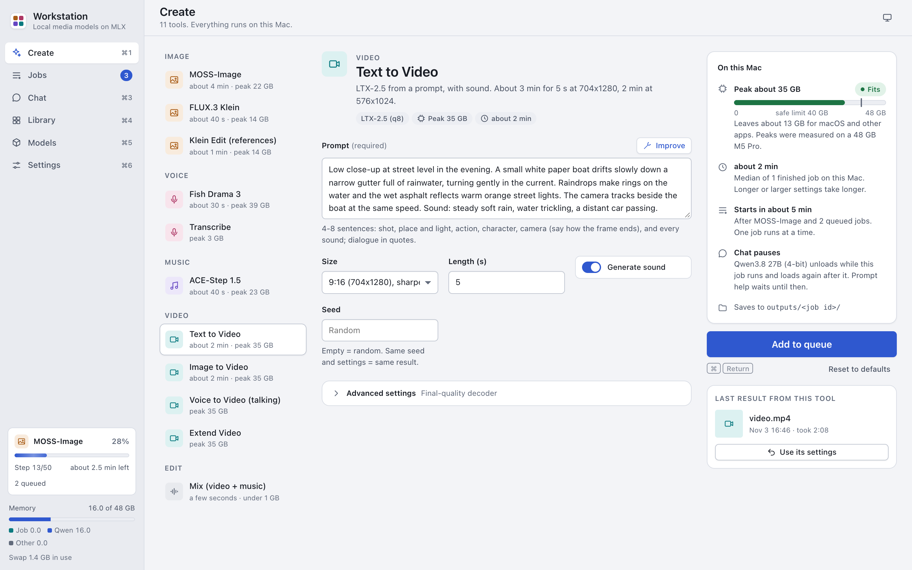
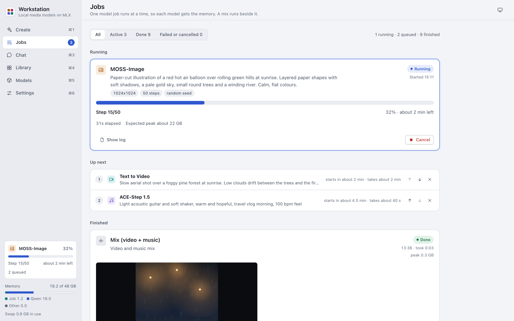
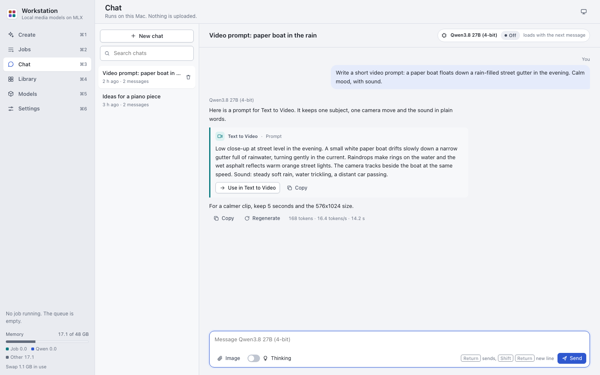
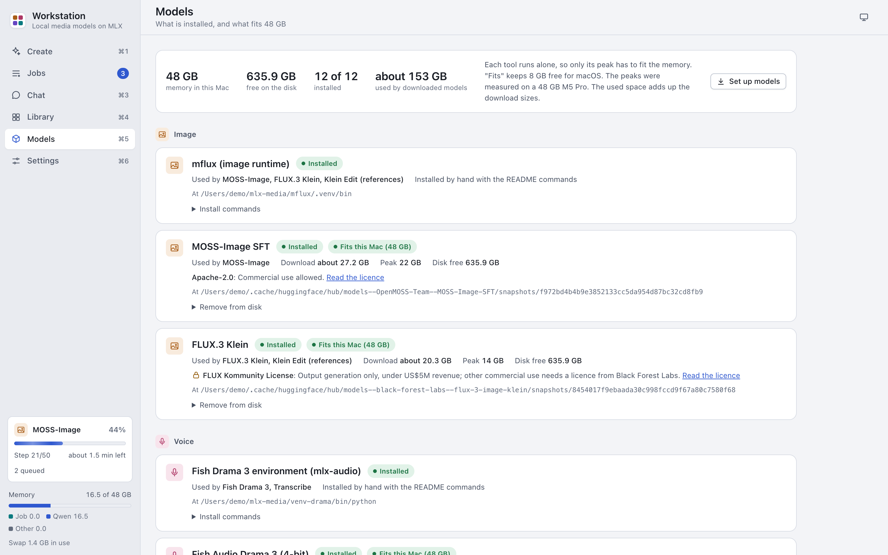
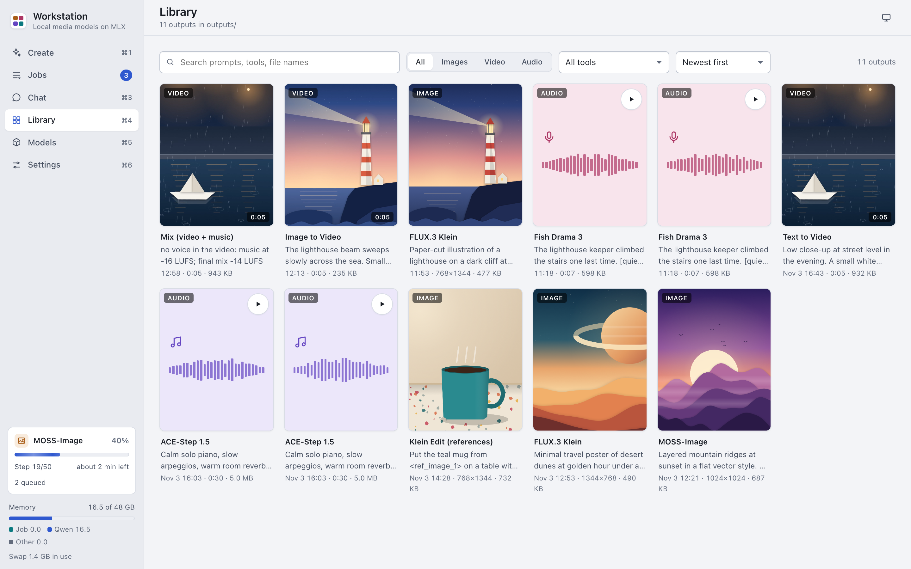
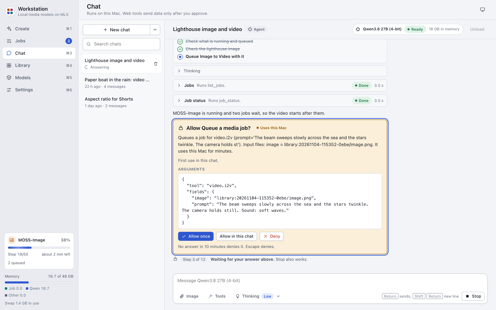
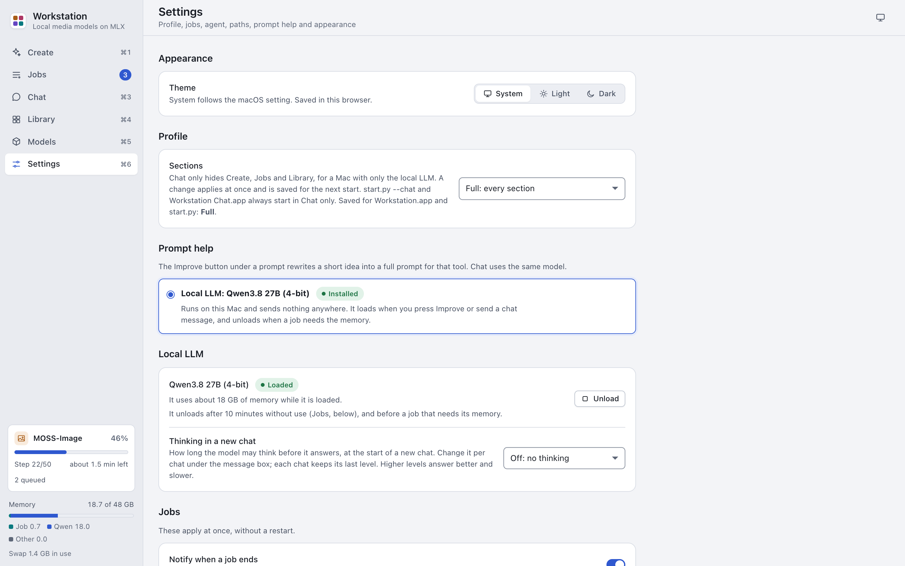
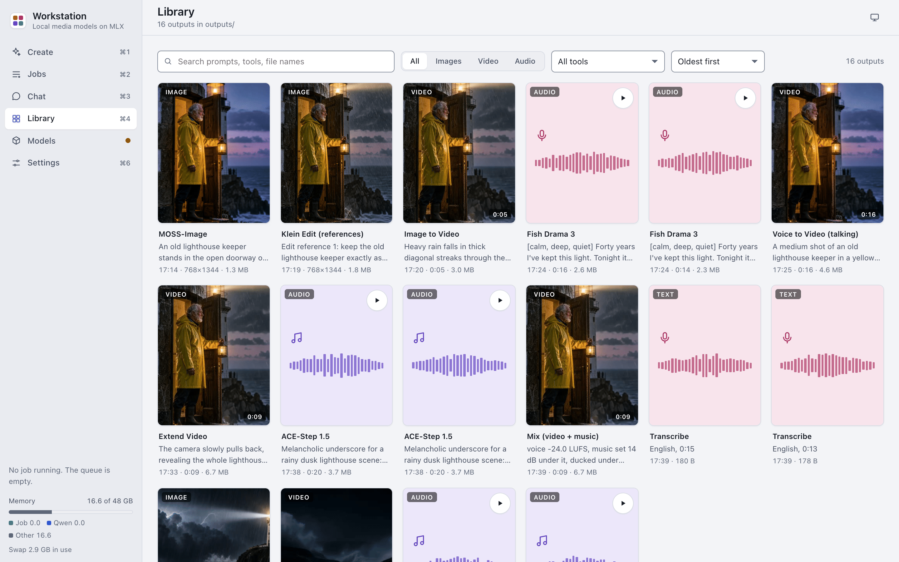
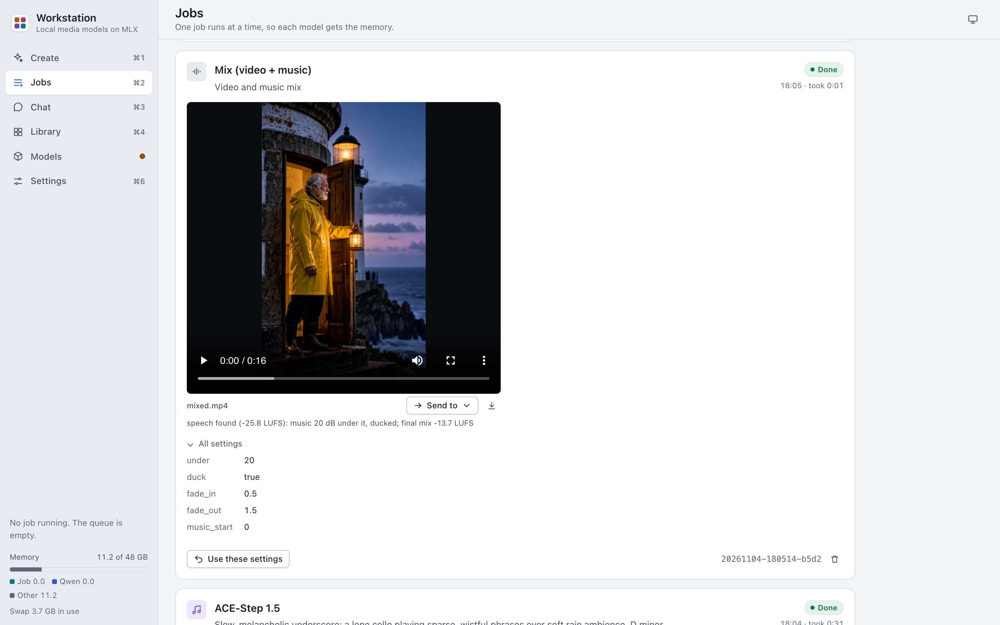
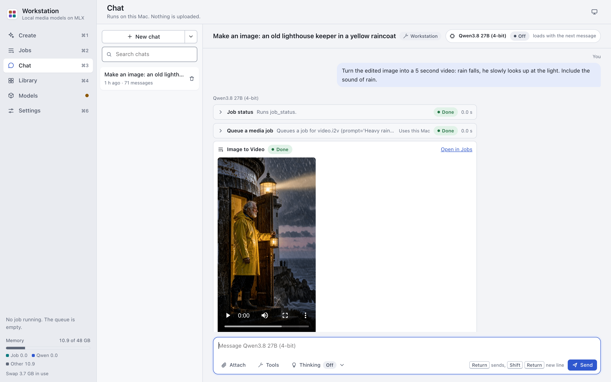

# MLX Media Workstation

MLX Media Workstation is a local Mac app for open image, voice, music and video models on Apple Silicon. Pick a
tool, fill in a form and press Generate. A local language model helps you write prompts and answers questions in a
chat. Every model runs on your Mac with [MLX](https://github.com/ml-explore/mlx). There is no account and no cloud
service.



- **11 tools in 5 groups**: images (MOSS-Image, FLUX.3 Klein, Klein Edit), voice (Fish Drama 3, Transcribe), music
  (ACE-Step 1.5), video with sound (LTX-2.5: text, image, voice and extend) and a video + music mix.
- **Prompt help**: "Improve" under a prompt field asks the local LLM to rewrite your draft for that tool.
- **Chat**: talk with a local Qwen3.8 27B. Attach images, documents (PDF, Word, Excel, text and code) or audio,
  pick a thinking level, and let it write prompts for the tools or queue the jobs itself.
- **Agent mode**: the chat model can search the web, read files in a folder you grant, run code in a sandbox and
  queue jobs. Each risky call asks you first.
- **Jobs and Library**: a queue with live progress and time left, and a searchable library of every output.
- **Models screen**: shows which models fit your Mac, and downloads the weights at pinned revisions.
- **Chat only**: a smaller profile for a Mac that has only the local LLM.

### What stays on your Mac

- The models run on your Mac. They upload nothing. They run with `HF_HUB_OFFLINE=1`, so they also download nothing
  while they work.
- The server listens on `127.0.0.1` only. The interface loads nothing from the network.
- The app connects to the network in two cases only:
  1. Downloads that you start on the Models screen (from Hugging Face).
  2. The web tools of an Agent chat (`web_search` and `fetch_url`), after you approve the call.

**The app includes no model weights.** You download each model yourself, and you must accept each model's licence.
See [Model licences](#model-licences).

## Contents

- [Requirements](#requirements)
- [Quick start](#quick-start)
- [User guide](#user-guide)
- [The app](#the-app)
- [Tools](#tools)
- [Memory](#memory)
- [Install the models](#install-the-models)
- [Model licences](#model-licences)
- [Troubleshooting](#troubleshooting)
- [Files and logs](#files-and-logs)
- [How it works](#how-it-works)
- [Development](#development)
- [Security](#security)
- [Licence](#licence)

## Requirements

- A Mac with Apple Silicon (M1 or newer). We built and tested the app on macOS 27.2 with an M5 Pro and 48 GB of
  memory. Other chips work, but jobs take longer.
- Enough memory for the tools that you want. See [Which tools fit my Mac](#which-tools-fit-my-mac).
- Free disk space for the models that you install: about 160 GB for all models and their environments. The
  download size of each model is in [Install the models](#install-the-models). The Models screen also keeps 10 GB free
  for macOS when it downloads.
- [Homebrew](https://brew.sh) with `ffmpeg`, `python@3.12`, `python@3.14` and `hf` (the Hugging Face command line):

  ```sh
  brew install ffmpeg python@3.12 python@3.14 hf
  ```

  We tested the media steps with ffmpeg 9.0.2. Older versions are not tested.

- [uv](https://docs.astral.sh/uv/) to make the Python environments:

  ```sh
  brew install uv
  ```

### Which tools fit my Mac

A tool fits when its peak memory plus 8 GB for macOS and other apps is at most the memory of the Mac. Jobs run one at
a time, so only the peak of one tool must fit.

| Tool | Peak memory | Smallest Mac |
|---|---|---|
| Mix (video + music) | none (ffmpeg only) | any |
| Transcribe | 3 GB | 16 GB |
| FLUX.3 Klein, Klein Edit (references) | 14 GB | 24 GB |
| Local LLM (Chat and "Improve") | 18 GB | 32 GB |
| MOSS-Image | 22 GB | 32 GB |
| ACE-Step 1.5 | 23 GB | 32 GB |
| Text to Video, Image to Video, Voice to Video, Extend Video | 35 GB | 48 GB |
| Fish Drama 3 | 39 GB | 48 GB |

In short:

- **16 GB**: Transcribe and Mix.
- **24 GB**: also FLUX.3 Klein and Klein Edit.
- **32 GB or 36 GB**: also MOSS-Image, ACE-Step 1.5, Chat and prompt help.
- **48 GB or more**: every tool.

We tested only on a 48 GB Mac. The rows for smaller Macs come from the rule above, not from tests. The Models screen
applies the same rule to your Mac and shows "Fits" on each model.

## Quick start

Do these steps in Terminal.

1. Clone the repository:

   ```sh
   git clone https://github.com/0xbyt4/mlx-media-workstation.git
   cd mlx-media-workstation
   ```

2. Make the app's Python environment:

   ```sh
   uv venv --python /opt/homebrew/bin/python3.12 .venv
   ```

3. Install the app's requirements:

   ```sh
   uv pip install --python .venv/bin/python -r requirements.txt
   ```

4. Make your configuration file:

   ```sh
   cp config.example.toml config.toml
   ```

   The default paths put every model under `~/mlx-media`. Keep them, or change them now or later in Settings > Model
   paths.

5. Build the two app launchers `Workstation.app` and `Workstation Chat.app`:

   ```sh
   scripts/build_apps.sh
   ```

   Keep the apps in the repository folder. Drag them to the Dock from there.

6. Start the app. Double-click `Workstation.app`, or run:

   ```sh
   .venv/bin/python start.py
   ```

7. Install a first model. FLUX.3 Klein is a good first choice: it fits a 24 GB Mac and makes an image in about 40 s.
   1. Make the mflux environment (step 1 of [Images](#images-moss-image-and-flux3-klein-mflux)).
   2. Accept the FLUX.3 Klein licence and log in to Hugging Face (see [Gated models](#gated-models)).
   3. On the Models screen, download FLUX.3 Klein.
8. Open Create, pick FLUX.3 Klein, write a prompt and press Generate.

For a chat-only setup, see [Chat only](#chat-only).

## User guide

The [user guide](docs/guide/README.md) explains each screen step by step:

- [Getting started](docs/guide/getting-started.md)
- [Create](docs/guide/create.md)
- [Jobs and Library](docs/guide/jobs-and-library.md)
- [Chat](docs/guide/chat.md)
- [Agent mode](docs/guide/agent-mode.md)
- [Models](docs/guide/models.md)
- [Settings](docs/guide/settings.md)
- [Troubleshooting](docs/guide/troubleshooting.md)
- [FAQ](docs/guide/faq.md)

## The app

The sidebar has six sections. Cmd-1 to Cmd-6 open them.

- **Create**: pick a tool, fill in its form and press Generate. The "On this Mac" card shows the tool's peak memory,
  whether it fits this Mac, the time it takes and the wait in the queue. The time is the median of the tool's
  finished jobs on this Mac ("No time yet" before the first one), so it does not change with the settings yet.
  "Improve" under a prompt field asks the local LLM to rewrite your draft. Undo brings your own text back.
- **Jobs**: the running jobs with their progress and time left, the queue, and the finished jobs with their results.
  Move a queued job up or down. "Use these settings" fills the form again. "Send to" puts an output into a file field
  of another tool.
- **Chat**: talk with the local LLM. See [Chat and agent mode](#chat-and-agent-mode).
- **Library**: every output of the finished jobs, with search and filters. A card opens a larger preview with "Use
  these settings", "Send to", "Download", "Show in Finder" and "Delete".
- **Models**: what each tool needs, what is installed, the download size, the peak memory and whether it fits this
  Mac. When models are missing, a setup card takes you through three steps: pick the models, accept the licences of
  the gated ones, and download.
- **Settings**: the theme, the prompt help provider, the local LLM, the profile, the job options, the agent options,
  the model paths and facts about the app. A change of a model path or an agent option takes effect after a restart.
  The other settings apply at once.

| Jobs | Chat |
|---|---|
|  |  |

| Models | Library |
|---|---|
|  |  |

| Agent mode | Settings |
|---|---|
|  |  |

| A whole story in the Library | Mix result |
|---|---|
|  |  |

### Chat and agent mode

You can attach up to 6 files to a message: up to 4 images (PNG, JPEG, WebP), text and code files, PDF, Word, RTF,
OpenDocument, Excel and HTML documents, and audio (WAV, MP3, M4A, AAC, FLAC, OGG, AIFF). The model reads the text of
a document and a transcript of an audio file. See [Chat](docs/guide/chat.md#ask-about-images-documents-and-audio).

A thinking level sets how long the model thinks before it answers: Off, Low, Medium, High, XHigh or Max. Settings >
Local LLM sets the level of a new chat. A chat keeps the last level that you used in it.

A new chat has one of three modes. The mode is fixed after the first message.

- **Workstation**: the model knows the app's tools and every field of their forms. When you ask it to make
  something, it queues the job itself with the Workstation tools, after you approve it. When it writes a prompt for a
  tool, the answer shows a "Use in" card. The card copies the text into that tool's form.
- **General**: a plain assistant.
- **Agent**: the model can call tools. It can search the web, read web pages, read and write files in a folder that
  you grant, look at images, run Python and shell commands in a sandbox, search the Library and queue jobs.



In Agent and Workstation mode, a call that sends data off the Mac, queues a job, writes a file or runs code shows an
approval card first. A Workstation chat has only the Workstation tools: no web, file, Python or shell tools. The Tools
menu of the chat turns tools on or off and, in Agent mode, grants the folder. Python and shell are off until you turn
them on. [docs/AGENT.md](docs/AGENT.md) has each tool, its risk level and the limits of the sandbox.

### Chat only

The chat profile shows only Chat, Models and Settings (Cmd-1 to Cmd-3), and opens on Chat. It has no Workstation
mode. Use it on a Mac that has memory for the local LLM but not for the media tools. It needs:

- A Mac with 32 GB of memory or more (the LLM's peak of about 18 GB plus the 8 GB reserve).
- About 16 GB of disk for the Qwen3.8 27B weights, plus the two Python environments.
- Homebrew `python@3.12` and `uv`. Only the agent's media tools (`media_info` and `view_image`) use `ffmpeg`.

Do these steps:

1. Do steps 1 to 5 of [Quick start](#quick-start).
2. Make the LLM environment `venv-qwen` (step 1 of [Local LLM](#local-llm-qwen38-27b-mlx-vlm)).
3. Start the chat profile. Double-click `Workstation Chat.app`, or run:

   ```sh
   .venv/bin/python start.py --chat
   ```

4. On the Models screen, download the Qwen3.8 27B weights.

`--chat` and `Workstation Chat.app` always start the chat profile. To make the chat profile the default for
`start.py` and `Workstation.app`, choose "Chat only" in Settings > Profile, or set `profile = "chat"` in the `[app]`
section of `config.toml`.

### Start options

```sh
.venv/bin/python start.py            # opens the app window
.venv/bin/python start.py --browser  # server only: open the link it prints in a browser
.venv/bin/python start.py --chat     # the chat profile: Chat, Models and Settings only
.venv/bin/python start.py --mcp      # the MCP server for local agents; the app must run
```

The app uses port 7870. When the app already runs and you start the other profile, `start.py` opens only a window on
the running app. It does not start a second server, so the local LLM loads only once. In all other cases where the
port is in use, `start.py` says so and stops.

Closing the app's own window, or Ctrl-C in `--browser` mode, cancels the queue and stops every model process.

### Use the tools from other agents (MCP)

Claude Code, Claude Desktop and other MCP clients on this Mac can use the media tools: read the memory and the queue,
queue jobs, wait for them and get the output files. The client starts `start.py --mcp`, which talks to the running
app on `127.0.0.1`. The jobs keep the app's memory and queue rules. [docs/MCP.md](docs/MCP.md) has the setup for each
client and the tools.

### Give the agent tools from MCP servers

The agent can also use the tools of other MCP servers: a program on this Mac or a remote service. Add them in
Settings > MCP servers. You approve each command line and each tool first, and the agent asks before every call.
Secrets go to the macOS Keychain. [docs/guide/mcp-servers.md](docs/guide/mcp-servers.md) has the steps.

## Tools

| Group | Tool | Model | Time on an M5 Pro | Peak memory |
|---|---|---|---|---|
| Image | MOSS-Image | MOSS-Image SFT (mflux, 8-bit) | about 4 min at 768x1344, 8 min at 1088x1920 | 22 GB |
| Image | FLUX.3 Klein | FLUX.3 Klein (mflux, 8-bit) | about 40 s | 14 GB |
| Image | Klein Edit (references) | FLUX.3 Klein with 1-10 reference images | about 1-4 min | 14 GB |
| Voice | Fish Drama 3 | Fish Audio Drama 3 (mlx-audio, 4-bit); Qwen3-ASR checks each take | about 2x real time | 39 GB |
| Voice | Transcribe | Qwen3-ASR 0.6B (mlx-audio, 8-bit): speech to text, with a time for about every 30 s | a few seconds for a minute of speech | 3 GB |
| Music | ACE-Step 1.5 | ACE-Step 1.5 turbo (MLX DiT and LM) | two takes in about 30 s | 23 GB |
| Video | Text to Video | LTX-2.5 distilled (ltx-2-mlx, q8), with sound | 5 s at 704x1280 in about 3 min, at 576x1024 in about 2 min | 35 GB |
| Video | Image to Video | LTX-2.5 from a start image | 4 s in about 2 min | 35 GB |
| Video | Voice to Video (talking) | LTX-2.5 audio-to-video: a person from an image speaks the audio | 7 s in about 3.5 min | 35 GB |
| Video | Extend Video | LTX-2.5 extend: continues a clip from its last second | 5 s more in about 2.5 min | 35 GB |
| Edit | Mix (video + music) | ffmpeg only: music under a video's own sound, ducked under speech, about -14 LUFS | a few seconds | none |

The peak memory is the value that the app plans with: the highest peak of the tools that use the same model. Most
jobs use less. We measured these ranges: MOSS-Image 20-22 GB, FLUX.3 Klein 11-14 GB, Fish Drama 3 26-39 GB (short
lines use less), Text to Video 23-29 GB, Image to Video about 28 GB, Voice to Video about 28 GB and Extend Video
29-35 GB.

Prompt help ("Improve") and Chat use the local LLM: Qwen3.8 27B, 4-bit (`mlx-community/Qwen3.8-27B-4bit`, run with
[mlx-vlm](https://github.com/Blaizzy/mlx-vlm)). It is a download of about 16 GB, and its peak is about 18 GB. It
loads on the first request. It unloads after 10 minutes without use. Settings > Jobs changes this time.

[docs/PROMPTING.md](docs/PROMPTING.md) has the prompt rules that worked for each model.

## Memory

Jobs that load a model run one at a time, because each model can use most of the memory of a 48 GB Mac. A Mix job
loads no model (ffmpeg only, a few seconds), so it runs next to the model job and does not wait for it.

The app keeps 8 GB for macOS and other apps. A model fits a Mac when its peak memory plus this 8 GB is at most the
memory of the Mac. On a Mac with less memory than a tool needs, macOS swaps, and the job gets much slower or fails.
On such a Mac, the "Improve" buttons stay hidden and Chat says that the Mac has too little memory for the LLM.

The local LLM shares the memory with the jobs:

- If a job fits next to the LLM, both stay in memory.
- If a job does not fit next to it, the answers in progress finish first (for at most 10 minutes). Then the LLM
  unloads and the job starts.
- A prompt help or chat request that you send while such a job runs waits. It runs when the job ends, before the next
  job starts.
- When no model job is queued, an LLM that such a job unloaded loads again in the background, if its last request
  was within the idle time.
- Before such a job, the LLM saves the prompt cache of its last chat to `outputs/llm-cache.safetensors`: 64 KiB for
  each token plus 0.15 GB, so about 0.75 GB for a chat of 9,000 tokens. The save takes about 1 second; the job waits
  for it for at most 10 seconds. After the job, the LLM reads the cache back, so the first answer in that chat reads
  only the new message, not the whole chat again.

## Install the models

Each model has two parts:

- **An environment** (or a code checkout) that runs it. You make it with the commands below. The Models screen shows
  the same commands on the cards of the runtimes.
- **The weights.** The Models screen downloads them. The commands below also give the `hf download` command for each
  model, if you prefer a terminal.

The commands put everything under `~/mlx-media`, the default in `config.example.toml`. The versions and revisions are
the ones that we tested. Newer versions can change command-line options.

Read each model's licence before you download it (see [Model licences](#model-licences)).

| Model | Download | Tools |
|---|---|---|
| MOSS-Image SFT | 27.2 GB | MOSS-Image |
| FLUX.3 Klein (gated) | 20.3 GB | FLUX.3 Klein, Klein Edit |
| Fish Audio Drama 3, 4-bit | 23.8 GB | Fish Drama 3 |
| Qwen3-ASR 0.6B, 8-bit | 1.0 GB | Fish Drama 3, Transcribe |
| ACE-Step 1.5 turbo | 10.1 GB | ACE-Step 1.5 |
| LTX-2.5 q8 (gated) | 54.1 GB | Text to Video, Image to Video, Voice to Video, Extend Video |
| Qwen3.8 27B, 4-bit | 16.1 GB | Chat, prompt help |

### Gated models

FLUX.3 Klein and LTX-2.5 are gated on Hugging Face. Do these steps once before you download them:

1. Open the model page, log in to Hugging Face and accept the licence:
   [FLUX.3 Klein](https://huggingface.co/black-forest-labs/flux-3-image-klein) and
   [LTX-2.5 (q8)](https://huggingface.co/dgrauet/ltx-2.5-mlx-q8).
2. In a terminal in the app folder, log in with a Hugging Face access token:

   ```sh
   .venv/bin/hf auth login
   ```

The app never asks for your token and never stores it. The Models screen and the `hf` command from Homebrew use the
same login.

### Download the weights in the app

1. Open the Models screen.
2. Pick the models in the setup card, or press Download on a model's card.
3. For a gated model, tick "I accepted the licence on Hugging Face".

Downloads run one at a time, in the order of the queue. Each download pins the same revision as the commands below.
The weights of MOSS-Image, FLUX.3 Klein and Qwen3-ASR go into the Hugging Face cache (`~/.cache/huggingface/hub`).
The other weights go to the paths in `config.toml`.

### Images: MOSS-Image and FLUX.3 Klein (mflux)

1. Get mflux at the tested commit and make its environment:

   ```sh
   git clone https://github.com/mflux-community/mflux.git ~/mlx-media/mflux
   cd ~/mlx-media/mflux
   git checkout a3b21fcaa88726b2267bd42bfc2e2d722f7d5a47
   uv sync --frozen --no-dev --python /opt/homebrew/bin/python3.12
   ```

2. Download the weights into the Hugging Face cache. mflux loads these revisions and reads only these folders.
   FLUX.3 Klein is gated.

   ```sh
   hf download OpenMOSS-Team/MOSS-Image-SFT --revision f972bd4b4b9e3852133cc5da954d87bc32cd8fb9 \
     --include "text_encoder/*" --include "tokenizer/*" --include "transformer/*" --include "vae/*"
   hf download black-forest-labs/flux-3-image-klein --revision 8454017f9ebaada30c998fccd9f67a80c7580f68 \
     --include "text_encoder/*" --include "transformer/*" --include "vae/*"
   ```

### Voice: Fish Audio Drama 3 and Qwen3-ASR (mlx-audio)

The Transcribe tool needs this environment and Qwen3-ASR, but not the Fish Drama 3 weights.

1. Make the environment:

   ```sh
   uv venv --python /opt/homebrew/bin/python3.14 ~/mlx-media/venv-drama
   uv pip install --python ~/mlx-media/venv-drama/bin/python "mlx-audio==0.6.1" scipy
   ```

2. Download the Fish Drama 3 weights and the speech recogniser Qwen3-ASR:

   ```sh
   hf download mlx-community/fish-audio-drama-3-4bit --revision 1ac1b2108b63c2ef5bade463a121569363e293ce \
     --local-dir ~/mlx-media/models/fish-audio-drama-3-4bit
   hf download mlx-community/Qwen3-ASR-0.6B-8bit --revision 89e96d92ba34aca20b3e29fb10cc284097d1219f
   ```

3. Point the cache's `main` ref at that Qwen3-ASR revision. mlx-audio loads Qwen3-ASR by name, and a download by
   revision writes no ref. The Models screen writes the ref for you.

   ```sh
   ref=~/.cache/huggingface/hub/models--mlx-community--Qwen3-ASR-0.6B-8bit/refs
   mkdir -p "$ref" && printf %s 89e96d92ba34aca20b3e29fb10cc284097d1219f > "$ref/main"
   ```

The 4-bit build fits a 48 GB Mac. The 8-bit build peaked at about 49 GB.

### Music: ACE-Step 1.5

1. Get ACE-Step at the tested commit and make its environment:

   ```sh
   git clone https://github.com/ACE-Step/ACE-Step-1.5.git ~/mlx-media/ace-step
   cd ~/mlx-media/ace-step
   git checkout ca1e85fe9430179831e6bc6be790c332190a3866
   UV_PYTHON_DOWNLOADS=never uv sync --frozen --python /opt/homebrew/bin/python3.12
   ```

2. Download the weights into the checkout's `checkpoints` folder. Make the checkout first, because `git clone`
   refuses a folder that is not empty.

   ```sh
   hf download ACE-Step/Ace-Step1.5 --revision 19671f406d603126926c1b7e2adc169acbcade22 \
     --local-dir ~/mlx-media/ace-step/checkpoints
   ```

Do not use ACE-Step's own `start_*_macos.sh` scripts. They update the checkout with git and start a web server.

### Video: LTX-2.5 (ltx-2-mlx)

1. Make the environment:

   ```sh
   uv venv --python /opt/homebrew/bin/python3.14 ~/mlx-media/venv-ltx
   uv pip install --python ~/mlx-media/venv-ltx/bin/python \
     "ltx-core-mlx @ git+https://github.com/dgrauet/ltx-2-mlx@b82b97e3d000e01361f8cfcb745244b15b89a521#subdirectory=packages/ltx-core-mlx" \
     "ltx-pipelines-mlx @ git+https://github.com/dgrauet/ltx-2-mlx@b82b97e3d000e01361f8cfcb745244b15b89a521#subdirectory=packages/ltx-pipelines-mlx"
   ```

2. Download the weights (gated). The tools use only the distilled transformer, so leave out the dev transformer
   (20 GB more):

   ```sh
   hf download dgrauet/ltx-2.5-mlx-q8 --revision 746ca9aacb697d2c739f544d68b584214dedcc75 \
     --exclude "transformer-dev.safetensors" --local-dir ~/mlx-media/models/ltx-2.5-mlx-q8
   ```

Do not install the PyPI package named `mlx-video` for this. It is a different project.

### Local LLM: Qwen3.8 27B (mlx-vlm)

Prompt help and Chat need this model. The app starts it with the Python in `qwen_python` (`config.toml`) and loads
the weights from `qwen_model`.

1. Make the environment:

   ```sh
   uv venv --python /opt/homebrew/bin/python3.12 ~/mlx-media/venv-qwen
   uv pip install --python ~/mlx-media/venv-qwen/bin/python "mlx-vlm==0.7.11" "mlx==0.32.4" "transformers==5.22.1"
   ```

2. Download the weights:

   ```sh
   hf download mlx-community/Qwen3.8-27B-4bit --revision 10c35caafbb80f7dc6a7a432cdd11af10a6d4818 \
     --local-dir ~/mlx-media/models/qwen3.8-27b-4bit
   ```

### Model paths

`config.toml` tells the app where each model is. A key that you leave out takes the default from
`config.example.toml`. A relative path counts from the repository folder. Settings > Model paths edits the same
keys; a change takes effect after a restart.

| Key | Default | What it is |
|---|---|---|
| `mflux_bin` | `~/mlx-media/mflux/.venv/bin` | The mflux environment (MOSS-Image, FLUX.3 Klein) |
| `drama_python` | `~/mlx-media/venv-drama/bin/python` | The Python of the Fish Drama 3 environment |
| `drama_model` | `~/mlx-media/models/fish-audio-drama-3-4bit` | The Fish Drama 3 weights |
| `ace_dir` | `~/mlx-media/ace-step` | The ACE-Step 1.5 checkout, with its `.venv` and `checkpoints` folders |
| `ltx_bin` | `~/mlx-media/venv-ltx/bin` | The LTX environment's `bin` folder |
| `ltx_model` | `~/mlx-media/models/ltx-2.5-mlx-q8` | The LTX-2.5 weights |
| `qwen_python` | `~/mlx-media/venv-qwen/bin/python` | The Python of the local LLM environment |
| `qwen_model` | `~/mlx-media/models/qwen3.8-27b-4bit` | The Qwen3.8 27B weights |

## Model licences

**Read this before you download a model.** The app includes no model weights. You download each model yourself, and
you must accept its licence. The MIT licence of this repository covers only its own code. Each model has its own
licence, and some licences limit commercial use.

The table is a short summary, checked on 2026-11-03. It is not legal advice. Read the full text before you use a
model or its output.

| Model | Licence | Commercial use | Source |
|---|---|---|---|
| MOSS-Image SFT | Apache-2.0 | Allowed. | [LICENSE](https://huggingface.co/OpenMOSS-Team/MOSS-Image-SFT/blob/f972bd4b4b9e3852133cc5da954d87bc32cd8fb9/LICENSE) |
| FLUX.3 Klein | FLUX Kommunity License v1.0 | Non-commercial use is allowed. Commercial use of the outputs is allowed only when your gross annual revenue (affiliates included) is less than US$5M. Then you must filter or review the outputs for unlawful content, and mark them as AI-made where the law requires it. Other commercial use needs a licence from Black Forest Labs. Do not use the outputs to improve a similar model. | [Model card](https://huggingface.co/black-forest-labs/flux-3-image-klein), [LICENSE.md](https://huggingface.co/black-forest-labs/flux-3-image-klein/blob/8454017f9ebaada30c998fccd9f67a80c7580f68/LICENSE.md) |
| Fish Audio Drama 3 | Fish Audio Community License v1.0 | Allowed while your annual revenue is less than US$500,000. No hosted text-to-speech service. Do not imitate a real person's voice without consent, do not remove the watermark, and do not train other speech models on the output. A product that uses it shows "Built with Fish Audio". | [LICENSE](https://huggingface.co/mlx-community/fish-audio-drama-3-4bit/blob/1ac1b2108b63c2ef5bade463a121569363e293ce/LICENSE) |
| Qwen3-ASR 0.6B | Apache-2.0 | Allowed. | [Model card](https://huggingface.co/mlx-community/Qwen3-ASR-0.6B-8bit) |
| ACE-Step 1.5 | MIT | Allowed. | [Model card](https://huggingface.co/ACE-Step/Ace-Step1.5) |
| LTX-2.5 | LTX-2.x Community License Agreement | Free for entities with less than US$10M annual revenue. At or above that, commercial use needs a paid licence from Lightricks. Keep the watermarks and AI disclosures, and follow the AI laws that apply to you. | [LICENSE-2_x](https://github.com/Lightricks/LTX-2/blob/main/LICENSE-2_x) |
| Qwen3.8 27B | Apache-2.0 | Allowed. | [LICENSE of the base model](https://huggingface.co/Qwen/Qwen3.8-27B/blob/main/LICENSE) |

The Fish Drama 3 tool is Built with Fish Audio.

The code that runs the models is MIT-licensed: mflux, mlx-audio, ACE-Step 1.5, ltx-2-mlx, mlx-vlm and MLX.

## Troubleshooting

The [troubleshooting guide](docs/guide/troubleshooting.md) has more cases.

**A job fails with "Not installed: <path>".** The tool's environment or weights are not at the path in `config.toml`.
Install the model (see [Install the models](#install-the-models)), or set its folder in Settings > Model paths and
restart the app.

**A download says "Hugging Face refused ...".** The model is gated, or you are not logged in. Accept its licence on
its Hugging Face page, run `.venv/bin/hf auth login` in the app folder, and try again.

**A download says "Not enough disk space".** The queue keeps 10 GB free for macOS. Pick fewer models or free some
space.

**`start.py` says "Port 7870 is in use".** The app is probably open already, or it is still closing. Wait a few
seconds and try again. If another program uses port 7870, stop that program.

**The app does not start and says "config.toml: ...".** The file has a syntax error, an unknown key or a bad value.
The message names it. Compare the file with `config.example.toml`.

**`Workstation.app` does nothing.** Read `outputs/app.log`. Keep the app in the repository folder: it starts the
copy of the app that it sits in. After you move the repository, run `scripts/build_apps.sh` again.

**A job is very slow or stops.** The Mac is probably short of memory and swaps. Quit other large apps. Check
"Fits" on the Models screen. Pick a smaller size, a shorter length or fewer takes.

**A chat answer shows "Waiting for memory".** A media job needs the memory of the LLM. The answer starts when the job
ends.

**The "Improve" buttons are missing.** The local LLM is not installed, or the Mac has too little memory for it (see
[Which tools fit my Mac](#which-tools-fit-my-mac)).

**The window shows "Server offline".** The server stopped. Start the app again. If it stops again, read
`outputs/app.log` or the terminal output.

## Files and logs

- Each job goes to `outputs/<job id>/`: `job.json` (the settings and the state), `job.log` (the model's output) and
  the result files. The app reads these folders at start.
- Each chat goes to `outputs/chats/<chat id>/`: `chat.json`, the images and files sent in it, and the text that the
  model read of each file.
- The local LLM writes its log to `outputs/llm.log`. After a big job, `outputs/llm-cache.safetensors` can hold the
  LLM's saved prompt cache of one chat.
- The MCP servers you add are in `outputs/mcp_servers.json`; each local server writes its output to
  `outputs/mcp/<name>.log`.
- When you start the app from `Workstation.app` or `Workstation Chat.app`, it writes its log to `outputs/app.log`.
  When you start it from a terminal, it writes the log to the terminal.

## How it works

- `start.py` starts the server on `127.0.0.1:7870` and opens a native window (pywebview, the system WebKit). The
  window signs in with a token of this run, so other programs and users on the Mac cannot use the API.
- `app/server.py` has the API ([docs/API.md](docs/API.md)), the job queue and the output files.
- `app/tools.py` has the tools, their form fields and defaults, and the command that each job runs.
- `app/models.py` has the model catalog (repositories, pinned revisions, sizes, peaks and licences) and the download
  queue.
- `app/llm.py` and `app/llm_worker.py` run the local LLM. The worker runs in the LLM environment and keeps the model
  loaded between requests.
- `app/agent/` has the tools, the approval policy and the sandboxes of agent mode ([docs/AGENT.md](docs/AGENT.md)).
- `app/mcp_server.py` offers the Workstation tools of agent mode to local MCP clients ([docs/MCP.md](docs/MCP.md)).
- `app/mcp_client.py` and `app/agent/mcp_tools.py` give the agent the tools of other MCP servers
  ([docs/MCP.md](docs/MCP.md#mcp-client)).
- `app/runners/` has small scripts that run inside a model's own environment.
- `web/` has the interface: plain HTML, CSS and JavaScript modules, with no build step and no network requests
  ([web/README.md](web/README.md)). [docs/DESIGN.md](docs/DESIGN.md) has the design notes of the interface.

Each model runs as its own process group from its own environment. A finished or cancelled job gives all its memory
back. The LLM worker is a process too, and it unloads the model when it exits.

## Development

The tests run no model and need no network. Install the development tools into the app's environment, then run the
checks:

```sh
uv pip install --python .venv/bin/python -r requirements.txt -r requirements-dev.txt
.venv/bin/ruff check .
.venv/bin/ruff format --check .
.venv/bin/python -m pytest -q
```

`.github/workflows/ci.yml` has the same checks for GitHub Actions on macOS. The workflow runs only when started by
hand, so run the checks on your Mac before you send a change. To send a change, read
[CONTRIBUTING.md](CONTRIBUTING.md). Everyone in the project follows the [code of conduct](CODE_OF_CONDUCT.md).

`scripts/make_icon.py` draws the app icons (`assets/AppIcon.icns` and `assets/icon.png`) from the colours in
`web/css/tokens.css`.

## Security

- The server listens on `127.0.0.1` only. It checks the Host and Origin headers, so other web pages in your browser
  cannot send jobs to it.
- In `--browser` mode, the browser sends the session cookie to every server on `127.0.0.1`. Use the app window when
  other local servers run.
- Uploaded files get fixed names, and the server sends back only media files.
- The jobs' ffmpeg and ffprobe calls open only local files with audio, video and image demuxers: a playlist or a
  concat list cannot make them read other files or the network.
- Agent mode runs model-written code only in a sandbox without network, and only after you approve each run.
  [docs/AGENT.md](docs/AGENT.md) lists what the sandbox does not protect.
- To report a vulnerability in private, see [SECURITY.md](SECURITY.md).

## Licence

The code of this repository is under the MIT licence. See [LICENSE](LICENSE). The models have their own licences.
See [Model licences](#model-licences).
