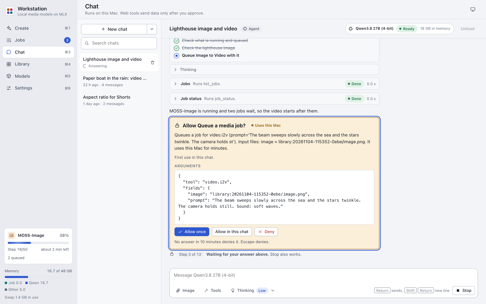

# Agent mode

In an Agent chat, the local LLM can call tools. It can search the web and read web pages. It can read and write files
in a folder you grant, and run Python and shell commands in a sandbox. It can search the Library and queue media jobs.
A call that sends data off this Mac, uses this Mac for minutes, writes files or runs code asks you first.

The full rules are in [AGENT.md](../AGENT.md). This page tells you how to use them.

## Start an Agent chat

1. Open Chat (Cmd-3).
2. Press "New chat".
3. Pick "Agent".
4. Optional: open the Tools menu under the message box. Turn tools on or off, and grant a folder.
5. Type your request, for example: `Search the web: when was the Antikythera mechanism found, and by whom?`
6. Press Return.

The model uses a tool only when it needs one. Each call shows as a card in the answer. A long task can show a plan:
a checklist at the top of the answer.

An answer has at most 12 steps and 10 minutes. The time that it waits for memory does not count.

## The tools and their risk

The Tools menu lists each tool with a pill that names its risk. The pill sets when the tool asks you.

| Pill | When it asks |
|---|---|
| App only | Never. It reads the app's own state. |
| Your folder | Never, once you granted a folder. Without a folder it is refused. |
| Uses this Mac, Leaves this Mac, Writes files | On the first use in the chat. You can allow it for the whole chat. |
| Changes files, Runs code | Before every call. |

| Tool | Pill | What it does |
|---|---|---|
| Plan | App only | Shows the answer's plan: a checklist of at most 10 steps. |
| Media tools | App only | Lists the media tools, their fields and whether their models are installed. |
| Job status | App only | Shows one job: status, progress, outputs and error. |
| Library search | App only | Finds finished outputs by text, tool or file name. |
| Queue a media job | Uses this Mac | Queues a media job, for example a Text to Video job. |
| Jobs | App only | Lists the queued, running and newest finished jobs. |
| Wait for a job | App only | Waits until a job ends, for at most 300 s. |
| Cancel a job | Uses this Mac | Cancels a job that this chat queued. It cannot cancel your other jobs. |
| Transcribe | Uses this Mac | Speech to text for an audio or video file, as a Transcribe job. |
| System status | App only | Shows the Mac's memory, the running job, the queue, the chat model and which media tools fit now. |
| List files | Your folder | Lists a folder inside the granted folder. |
| Read a file | Your folder | Reads a text file in the granted folder. |
| Search files | Your folder | Searches the text files of the granted folder. |
| Write a file | Writes files | Creates a new text file in the granted folder. It never overwrites a file. |
| Change a file | Changes files | Changes a text file in the granted folder. The card shows the change. A copy of the old file goes to the chat's work folder first. |
| Copy to work folder | Your folder | Copies a file from the granted folder into the chat's work folder, for Python. |
| Save to your folder | Writes files | Copies a file from the work folder into the granted folder, under a new name. |
| Media facts | Your folder | Reads the length, size and codecs of a media file in the granted folder, the work folder or the Library. It runs without a folder too. |
| View an image | Your folder | Lets the model see an image in the granted folder, the work folder or the Library. It runs without a folder too. |
| Web search | Leaves this Mac | Searches the web. It sends the query off this Mac. |
| Read a web page | Leaves this Mac | Reads one public web page as text. It sends the address off this Mac. |
| Python | Runs code | Runs Python in a sandbox with no network and no access to your files. |
| Shell | Runs code | Runs shell commands in a sandbox with no network. It reads the granted folder without changing it. |

The chat profile has no media tools, jobs, Library or Transcribe: it shows only the other tools.

## Answer an approval card

A call that asks shows an approval card with the tool and its arguments. For "Read a web page", the card shows the
host on its own line. For "Change a file", it shows the change.

1. Read the card.
2. Press one of these:
   - **Allow once**: the call runs.
   - **Allow in this chat**: the call runs, and later calls of this tool in this chat run without asking. Not offered
     for "Changes files" and "Runs code".
   - **Deny**: the call does not run. The model gets the reason.

No answer in 10 minutes counts as Deny. Stop also works while a card waits.

To take back "Allow in this chat", open the Tools menu and press Revoke next to "Allowed in this chat".

### Untrusted content

Web pages, files, Library text and program output can hold text that tries to steer the model. After such content
comes into a chat, the Tools menu shows a note. It starts with "Web pages, files or program output are in this chat".
A document or audio file that you attach to a message counts as such content too. An attached image does not.

From then on, every "Uses this Mac", "Leaves this Mac" and "Writes files" call asks, also after "Allow in this chat".
Web search, Read a web page and Transcribe ask every time after their first result. Read each card before you allow
it.

## Turn tools on or off

1. Open the Tools menu under the message box.
2. Click the switch of a tool.

A new Agent chat has every tool on, except Python and Shell. When the model needs a tool that is off, it asks you to
turn it on.

## Turn on Python or Shell

1. Open the Tools menu.
2. Turn on Python or Shell.
3. Ask for the task, for example: `Use Python to find the sum of the first 1000 prime numbers.`
4. Read the code on the approval card. Press "Allow once" only when you agree with it.

Python and Shell are in the menu only when the sandbox works on this Mac. Settings > Agent shows why when it does not.

| | Python | Shell |
|---|---|---|
| Runs | Python code | zsh commands, with the programs in `/bin`, `/usr/bin` and Homebrew |
| Reads | The chat's work folder | The chat's work folder and the granted folder |
| Writes | The chat's work folder | The chat's work folder |
| Network | None | None |
| Time | 60 s | 120 s by default, at most 600 s |
| Memory | 2,048 MB | 2,048 MB for all its processes |

The files that the code writes stay in the work folder for later calls in the same chat: `outputs/chats/<chat
id>/ws/`. The page shows images and links to other files.

By default, Python has only the standard library. To use numpy, pandas or matplotlib, see
[Settings > Agent](settings.md#agent).

## Grant a folder

The file tools and Shell work only in the folder that you grant to the chat.

1. Open the Tools menu.
2. Under "Folder the file tools and Shell may use", type the full path of the folder, for example
   `/Users/you/Documents/notes`.
3. Press Grant, or press Return.

The grant holds for this chat only. Press Revoke to take it back.

- The tools reach this folder and its subfolders only.
- They never read or write hidden files (a name that starts with `.`) or key and password files.
- They read text files only. "Copy to work folder" copies any file type.
- When you move the folder, the grant stops working. Grant it again.

The app refuses these folders and everything inside them:

- `/`, the folders directly under `/`, your home folder itself and the folders above it.
- System folders and `~/Library`.
- `/Applications`, `~/Applications` and `/opt`.
- App bundles and Python package folders (`site-packages`, `dist-packages`).
- `/private/var` and `/private/tmp` (also as `/var` and `/tmp`).
- Other users' folders.
- The app's own folder.
- Paths with a hidden part.

So grant a subfolder, such as a project folder in Documents.

## Queue media jobs from the chat

The model can queue a job with "Queue a media job". The card lists the fields and the input files. An input file
can be a Library output, a file in the work folder or a file in the granted folder.

- A job that fits next to the LLM (an image, or a transcription on a 48 GB Mac) can run during the answer.
- A job that does not fit (a video, for example) starts after the answer. The model tells you so. The job card shows
  its progress.

## Web search sources

Web search asks these sources one after another:

1. Your own SearXNG instance, when you set its address in Settings > Agent.
2. Wikipedia, in the language set in Settings > Agent (English by default).
3. Marginalia Search, when it is on in Settings > Agent (on by default). Its shared key is often rate limited.

## Links in agent answers

A link in an agent answer shows its host after its text, for example "label (example.com)". A link with a query also
shows the query. So you can see where a click sends you, and what text it sends, before you click.

## What the sandbox does not protect

Read the list in [AGENT.md](../AGENT.md#what-is-not-protected) before you turn on Python or Shell. For example,
Apple has deprecated the sandbox technology (`sandbox-exec`), and the code can learn which files exist on the Mac.
