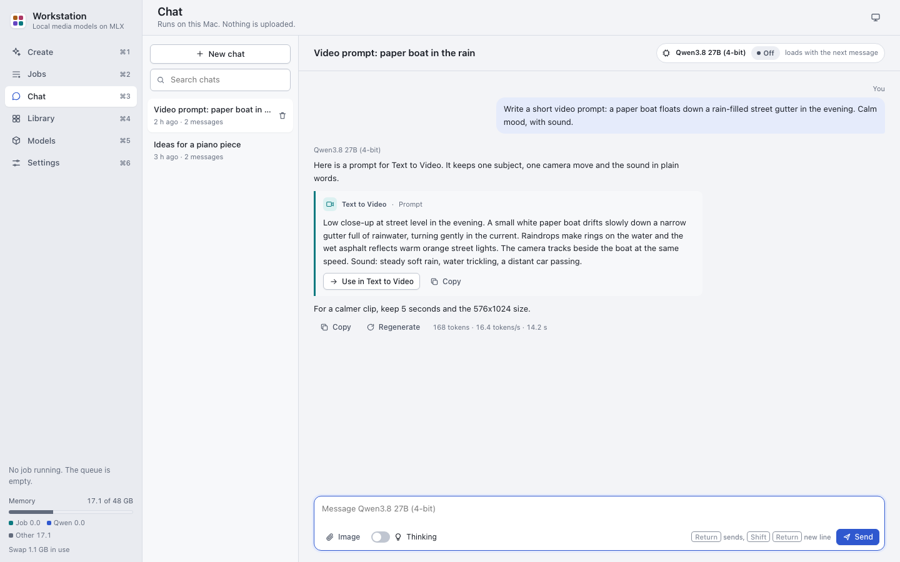

# Chat

Chat lets you talk with the local LLM: Qwen3.8 27B, 4-bit. The model runs on this Mac and uploads nothing.

The model needs about 26 GB of memory: its peak of about 18 GB plus 8 GB for macOS. It loads with the first message,
which reads about 16 GB from disk. It unloads after 10 minutes without use. See
[Settings > Jobs](settings.md#jobs) to change this time.

## Start a chat

1. Open Chat (Cmd-3).
2. Press "New chat". To pick the mode at once, open the "New chat in a mode" menu next to it.
3. On the empty chat, pick a mode: Workstation, General or Agent.
4. Type your message.
5. Press Return to send. Press Shift-Return for a new line.

The mode is fixed after the first message. A new chat starts in the mode of your last new chat.

| Mode | What it does |
|---|---|
| Workstation | Knows the app's tools. When it writes a text for a tool, the answer shows a "Use in" button. |
| General | A plain assistant for any question. It does not know the app's tools. It has no internet access. |
| Agent | A general assistant that can use tools: web search, Python in a sandbox, files in a folder you grant. See [Agent mode](agent-mode.md). |

The chat profile has no Workstation mode.

## Use a prompt from the chat in a tool

1. Start a chat in Workstation mode.
2. Ask for a prompt, for example: `Write a Text to Video prompt for a 5 second shot of a lighthouse at night.`
3. Under the prompt in the answer, press "Use in Text to Video".

Create opens that tool with the text in its field. Read it, then press Generate.

## Ask about an image

1. Press the image button under the message box, or drop or paste the images on the chat.
2. Type your question.
3. Press Return.

You can attach up to 4 images to a message: PNG, JPEG or WebP, 20 MB each.

## Pick a thinking level

The model can think before it answers. A higher level thinks longer and answers better, but slower.

1. Press "Thinking" under the message box.
2. Pick a level.

| Level | Thinks for at most |
|---|---|
| Off | No thinking: the fastest answer. |
| Low | About 1 minute. |
| Medium | About 3 minutes. |
| High | About 6 minutes. |
| XHigh | About 8 minutes. |
| Max | No thinking limit, up to the answer's time limit. |

- A chat keeps the last level that you used in it.
- A new chat starts with the level in [Settings > Local LLM](settings.md#local-llm) ("Thinking in a new chat").
- The times assume about 17 tokens a second, as on an M5 Pro. A slower Mac thinks for fewer words in that time.
- In an agent answer, the limit applies to each step. Steps after the first get 40% of it.

The thought shows in a block above the answer, folded. Click "Thinking" to open it. The token budgets are in
[API.md](../API.md#thinking-levels).

## Control an answer

- **Stop**: the Send button changes to Stop while the model answers. Press it to end the answer. The app keeps the
  text so far.
- **Regenerate**: under the last answer. It answers the last message again.
- **Copy**: under an answer, and on each code block.

An answer can take at most 10 minutes. At the limit it stops and shows a note. The time that the answer waits for
memory does not count.

## When a job runs

The LLM and a media job share the memory.

- When a job fits next to the LLM, both stay in memory.
- When a job does not fit, the answers that run finish first (for at most 10 minutes). Then the LLM unloads and the
  job starts.
- A message that you send while such a job runs waits. The chat shows "Waiting for memory". The answer starts when
  the job ends, before the next queued job.

## Manage chats

- To find a chat, type in "Search chats".
- To delete a chat, press its delete button, then press Delete. This deletes the chat and its images.
- To free the LLM's memory now, press the unload button in the chat header. The model loads again with the next
  message.

A chat is saved in `outputs/chats/<chat id>/`. The model sees at most 32,768 tokens of a chat. When a long chat is
full, the oldest turns go out of the model's view. They stay on the page.

## Chat only

The chat profile shows only Chat, Models and Settings. Use it on a Mac with only the local LLM installed.

To start the chat profile, do one of these:

- Run `.venv/bin/python start.py --chat`.
- Open `Workstation Chat.app`.
- Choose "Chat only" in [Settings > Profile](settings.md#profile). The change applies at once and is saved for the
  next start.

To set up a Mac only for chat:

1. Make the app's environment and `config.toml`. See [Getting started](getting-started.md#install-the-app).
2. Make the LLM environment. Run the commands that the Models screen shows on the "Local LLM environment (mlx-vlm)"
   card.
3. Start the app with `--chat`.
4. On the Models screen, download "Qwen3.8 27B (4-bit)" (about 16.1 GB).

The chat profile does not need `ffmpeg`. In the chat profile, Settings shows "Memory" in place of "Jobs".
