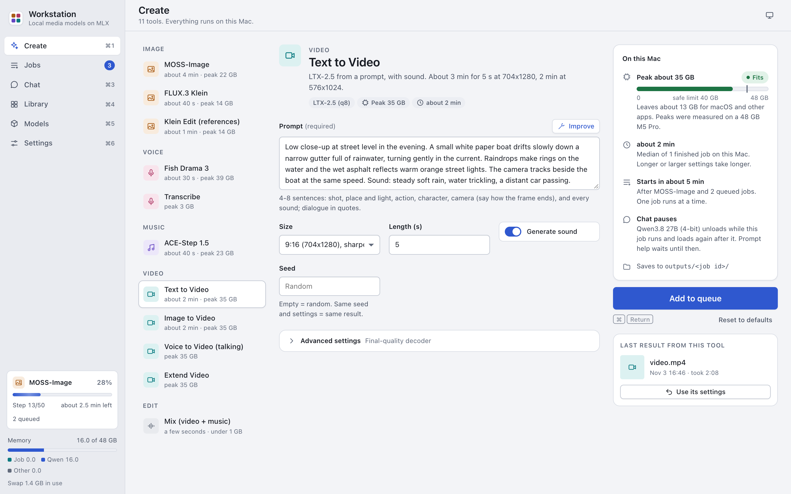

# Create

On the Create screen you pick a tool, fill in its form and start a job. Jobs that load a model run one at a time, so
each model gets the memory it needs. The Edit tools (Mix, Join clips, Add Subtitles) load no model, so their jobs
start next to a running model job.

## Start a job

1. Open Create (Cmd-1).
2. Click a tool in the tool list. Each row shows the tool's peak memory, "Tight" or "Needs N GB", or "Not
   installed". After the first job of the tool on this Mac, it shows the time too.
3. Fill in the fields. A field marked "(required)" must have a value.
4. Optional: open "Advanced settings" for the other fields. Its summary names them.
5. Read the "On this Mac" card. See [The "On this Mac" card](#the-on-this-mac-card).
6. Press Generate, or press Cmd-Return.

When a job runs already, the button says "Add to queue". When the tool's model is not installed, the button says
"Install first".

The job goes to the queue. A toast offers "View in Jobs". See [Jobs and Library](jobs-and-library.md).

Other controls of the form:

- **Seed**: empty means random. The same seed and settings give the same result.
- **Reset to defaults**: puts every field of the tool back to its default.
- **Last result from this tool**: the newest finished job of the tool. "Use its settings" fills the form with its
  settings.
- **File fields**: press "Choose" or drop a file on the field. A file can be at most 200 MB.
- **Image files**: an image field takes PNG, JPEG, WebP, GIF, HEIC and HEIF. The app converts a HEIC or HEIF photo
  (an iPhone photo) to PNG with the macOS tool `sips`. From an animated GIF, it uses the first frame. Image to Video,
  Voice to Video, Improve and the reference images of Klein Edit (references) put a transparent image on a white
  background first: LTX-2.5, FLUX.3 Klein and the LLM cannot use transparency, so its edges would look wrong.

The form remembers its values per tool in this window. It does not remember the chosen files after a restart.

## The "On this Mac" card

The card next to Generate shows these facts before you start:

- **Peak**: the highest memory that the tool's model uses, against the memory of this Mac. A pill says "Fits",
  "Tight" or "Needs N GB". See [Models](models.md#read-the-memory-fit).
- **Time**: the median time of the finished jobs of this tool on this Mac. Before the first job, it says "No time
  yet". The tool's description gives the time that we measured.
- **Queue**: "Starts now", or how long the jobs before it take.
- **Chat pauses**: the local LLM unloads while this job runs, because both do not fit in the memory together. Prompt
  help and Chat wait until the job ends.
- **Saves to**: `outputs/<job id>/`.

The peaks were measured on a 48 GB M5 Pro. The app plans with one peak per model: the highest peak of the tools that
use it. So the card shows 35 GB for every LTX-2.5 tool and 39 GB for Fish Drama 3.

## Improve a prompt

"Improve" is under the main text field of most tools. It asks the local LLM to turn your short idea into the full
text that the tool needs. It follows the rules in [PROMPTING.md](../PROMPTING.md).

1. Type a short idea in the field, for example `a fox in snow at dawn`.
2. Press Improve.
3. Read the new text and the note under it.
4. To get your own text back, press Undo. To get the new text again, press Redo.

- Improve sees the images of the form (for Image to Video, the start image). For a video, it sees the frame where
  the clip ends. It never gets the audio.
- The first request loads the LLM. This reads about 16 GB from disk.
- When a job runs that does not fit next to the LLM, Improve waits. It runs when that job ends, before the next
  queued job. Your text stays in the field. Press Cancel to stop the wait.
- On a Mac with less than about 26 GB of memory, the Improve buttons do not show.

## The tools

The times and peaks below come from an M5 Pro with 48 GB. "Peak" is the number that the app plans with.

| Group | Tool | What it makes | Time | Peak |
|---|---|---|---|---|
| Image | MOSS-Image | Photoreal people and scenes | about 4 min at 768x1344, 8 min at 1088x1920 | 22 GB |
| Image | FLUX.3 Klein | Fast images, good text in images | about 40 s | 14 GB |
| Image | Klein Edit (references) | A new image from 1-10 reference images | about 1-4 min | 14 GB (not measured with many references) |
| Voice | Fish Drama 3 | Expressive speech and dialogue | about 2x real time | 39 GB |
| Voice | Transcribe | Text from speech | 40 s of speech in about 2 s | 3 GB |
| Music | ACE-Step 1.5 | Music, instrumental or with lyrics | two 20 s takes in about 30 s | 23 GB |
| Video | Text to Video | A video with sound from a prompt | 5 s at 704x1280 in about 3 min, at 576x1024 in about 2 min | 35 GB |
| Video | Image to Video | A video from a start image | 4 s in about 2 min | 35 GB |
| Video | Voice to Video (talking) | A person from an image speaks your audio | 7 s in about 3.5 min | 35 GB |
| Video | Extend Video | More seconds after a clip | 5 s more in about 2.5 min | 35 GB |
| Edit | Mix (video + music) | Music under a video's own sound | a few seconds | under 1 GB (ffmpeg only) |
| Edit | Join clips | One video from 2-10 videos and still images | 10 s at 704x1280 in under 1 s | about 1 GB at 704x1280 (ffmpeg only) |
| Edit | Add Subtitles | A video with a subtitle track | a few seconds | under 1 GB (ffmpeg only) |

### MOSS-Image

Photoreal, aesthetic people and scenes. It is weak at text in images.

| Field | Default | Notes |
|---|---|---|
| Prompt | | One paragraph of about 100-200 words, in English. A counter shows "about N of 400 tokens". |
| Size | 9:16 (768x1344) | Also 9:16 large (1088x1920), 4:5 (896x1152), 1:1 (1024x1024), 16:9 (1344x768). |
| Seed | random | |
| Negative prompt (advanced) | `nsfw, worst quality, bad anatomy, watermark, jpeg artifact` | |
| Steps (advanced) | 50 | 10 to 100. The model's guide recommends 50 or more. |
| Guidance (CFG) (advanced) | 4.0 | 1 to 8. Use 3-6: higher for short prompts. |

Prompt tips:

- Describe the subject, outfit, pose, framing, lens, light, place and style. Skip empty quality tags.
- Keep the prompt under about 400 tokens. A longer prompt gives a black image (mflux bug 920).
- For a full-body 9:16 image with small faces, use 1088x1920.
- For text in the image, use FLUX.3 Klein.
- For the same character in many images, keep the seed and the words that describe the person. Change only the pose,
  framing and place.

### FLUX.3 Klein

Fast images. It is good at text in images and at following the prompt.

| Field | Default | Notes |
|---|---|---|
| Prompt | | Put any text to render in double quotes, for example a sign that reads "PUSH". |
| Size | 9:16 (768x1344) | The same sizes as MOSS-Image. |
| Seed | random | |
| Steps (advanced) | 16 | 4 to 50. |

Prompt tips:

- Write in this order: medium, subject and action, place, light (source, direction, colour), framing (shot size,
  angle, lens).
- Write a full caption, not a one-line command.
- Klein has no negative prompt. Describe what you want instead.

### Klein Edit (references)

A new image from 1-10 reference images: the same person in a new place, or objects combined.

| Field | Default | Notes |
|---|---|---|
| Reference images | | 1 to 10 images. |
| Prompt | | Name the references `<ref_image_0>`, `<ref_image_1>` and so on, in upload order. |
| Size | 9:16 (768x1344) | The same sizes as MOSS-Image. |
| Seed | random | |

Prompt tips:

- Put the background first.
- Give each reference one role. Say what must stay the same.
- The model shrinks each reference to about 1 megapixel. A small face in a full-body image loses its identity. Add a
  head-and-shoulders reference for faces.

### Fish Drama 3

Expressive speech and dialogue. Speech recognition (Qwen3-ASR) checks each take.

| Field | Default | Notes |
|---|---|---|
| Script | | The text to speak. See the tips below. |
| Takes | 2 | 1 to 4. Each take uses another seed. Keep the best. |
| Voice reference, speaker 0 (advanced) | | An audio file: 10-20 s, one clean voice, 44.1 kHz or better. |
| Transcript of reference 0 (advanced) | | Required when you give the reference. |
| Voice reference, speaker 1 (advanced) | | The same, for the second speaker. |
| Transcript of reference 1 (advanced) | | Required when you give the reference. |
| Temperature (advanced) | 1.0 | 0.3 to 1.5. |
| Top p (advanced) | 0.9 | 0.1 to 1.0. |
| Top k (advanced) | 30 | 5 to 200. |

The output is `take1.wav`, `take2.wav` and so on. Each take is raised toward -16 LUFS. The gain stops where the
loudest sample reaches -1 dBFS, so a take never clips, and it is at most +20 dB. The note of each take says "checked ok" or "CHECK FAILED" with
the reason. The check finds a wrong length, a silence of 3 s or more, or more than 15% of the words not heard. A take that
fails the check is made once more with another seed.

Prompt tips:

- Mark the speakers with `<|speaker:0|>` and `<|speaker:1|>`. Write the whole exchange as one text.
- Use 2-4 short turns of 5-20 words each, under about 300 bytes per take.
- Plan about 2.5 words for each second of speech. For 10 seconds, write about 25 words.
- Put cues in brackets where they happen, if possible mid-sentence: `[sighs]`, `[nervous laugh]`. A cue lasts until
  the next one.
- Make pauses with "...", a dash, a comma or a new short sentence.
- Do not start a take with a one-word sentence or a cue. The take often stops there.
- Do not ask for `[long pause]` or screams. The model can get stuck in silence or noise.
- The app removes line breaks.
- Keep temperature 1.0 and top p 0.9. Low values make silent takes more likely.
- For two cloned voices, pick clearly different voices. If speaker 1 drifts, swap the two references.

### Transcribe

Speech to text with Qwen3-ASR 0.6B. It writes one line of text for about every 30 s, with its time.

| Field | Default | Notes |
|---|---|---|
| Audio or video | | The file's sound track is transcribed. Music under the voice makes the text worse. |
| Language | Detect (per 30 s part) | Or one of 30 languages. |
| Subtitles (SRT and VTT) | off | Also writes `transcript.srt` and `transcript.vtt`. |

The output is `transcript.txt`: a `Language:` line, then one line per part with its time, for example
`[0:00-0:28] ...`. It has no times for single words.

With Subtitles on, the tool cuts the audio into parts of about 6 s at quiet points, instead of 30 s parts. Then
`transcript.txt` has one line for each short part. The tool also writes `transcript.srt` and `transcript.vtt`:

- A subtitle has at most 2 lines of 42 characters (16 characters in Chinese, Cantonese and Japanese).
- A subtitle shows for 1-6 s. A pause of 0.8 s or the end of a sentence starts a new subtitle.
- Qwen3-ASR gives no time for each word. The words of a part share the time from its first to its last loud sound,
  by their length. So a subtitle can start or end about 1 s early or late.

Use `transcript.srt` in Add Subtitles ("Send to" on the file), or open it with the video in a player.

### ACE-Step 1.5

Music from a description, instrumental or with lyrics.

| Field | Default | Notes |
|---|---|---|
| Description | | Genre, mood, instruments, tempo feel and use. |
| Instrumental | on | Turn it off for a song with lyrics. |
| Lyrics | | Sung only when Instrumental is off. Use `[verse]` and `[chorus]` tags. |
| Duration (s) | 30 | 10 to 240. |
| BPM (advanced) | automatic | 30 to 300. |
| Key (advanced) | automatic | For example `D minor`. |
| Takes (advanced) | 2 | 1 to 4. |
| Seed (advanced) | random | |

Lyrics need Instrumental off:

- When you type or paste lyrics while Instrumental is on, the form turns Instrumental off. A note says so. Press Undo
  in the note to turn it on again. After Undo, or when you turn Instrumental on yourself, the form leaves it on until
  you clear the lyrics.
- "Use in ACE-Step 1.5 › Lyrics" in a chat also turns Instrumental off. Undo in its note puts the form back.
- With Instrumental on and text in Lyrics, Generate marks the Lyrics field. The server also refuses such a job, so
  the app never ignores lyrics.

The output is `take1.wav`, `take2.wav` and so on. Each note gives the seed, the key and the BPM.

Example description: `tense escape room thriller underscore, ticking clock`.

### Text to Video

LTX-2.5 makes a video with sound from a prompt.

| Field | Default | Notes |
|---|---|---|
| Prompt | | 4-8 sentences. See the tips below. |
| Size | 9:16 (704x1280) | Also 9:16 fast (576x1024), about 2x faster with softer faces; 16:9 (1024x576); 1:1 (768x768). |
| Length (s) | 5 | 1 to 10. |
| Generate sound | on | |
| Seed | random | |
| Final-quality decoder (advanced) | off | Slightly cleaner skin and faces, about 2.5x slower in total. |

The output is `video.mp4` at 24 frames a second. After LTX-2.5 writes it, the app tags its colours (BT.709) and puts
its index at the start of the file, so players show the right colours and can start before the whole file is read.
This step copies the video and the sound as they are. If it fails, the job keeps the untagged file. Image to Video
and Voice to Video do the same. Extend Video writes the same tags when it joins the clip and the new part.

Prompt tips for all LTX-2.5 tools:

- Write one paragraph of 4-8 sentences in the present tense: shot, place and light, action with real verbs,
  character, camera and sound.
- Show emotion with physical cues, not with words such as "sad".
- Say how the frame looks at the end, relative to the subject. "Static frame, locked-off camera, no zoom" stops a
  drifting zoom.
- Name every sound. Put dialogue in quotes. Plan about 2.5 words a second.
- Use the same words for a character in every shot.
- Faces need pixels. When the face matters, frame a medium shot or closer, or use 704x1280.
- Make the clip a little longer and trim the end. The last second can flash or blur.

### Image to Video

LTX-2.5 animates a start image.

| Field | Default | Notes |
|---|---|---|
| Start image | | The app scales and crops it to the video size. Use the same aspect ratio. |
| Prompt | | Describe what changes, not what the image shows. |
| Size, Length (s), Generate sound, Seed, Final-quality decoder | | As in Text to Video. |

To make a video from an image:

1. Make an image with MOSS-Image or FLUX.3 Klein in the same aspect ratio as the video, for example 9:16.
2. On the finished job, press "Send to" and pick Image to Video. Create opens with the image in "Start image".
3. Describe the motion and the sound, for example: `She turns her head toward the window and smiles. Rain taps on
   the glass. Static frame, locked-off camera, no zoom.`
4. Press Generate.

A prompt that describes another place makes the model cut or fade.

### Voice to Video (talking)

A person from an image speaks your audio, with the lips in sync. The clip is as long as the audio.

| Field | Default | Notes |
|---|---|---|
| Person image | | Front-facing and sharp. The face must be large: waist-up works best. |
| Voice audio | | One speaker, a clean voice, 1.5-20 s. |
| Who and how | | Who speaks, where, and the exact words in quotes. |
| Size | 9:16 fast (576x1024) | The video sizes. |
| Added camera/face wording (advanced) | a fixed text | The app adds this text to your prompt: a static camera, natural lips, sharp eyes. |
| Seed | random | |

To make a talking video:

1. Make the voice with Fish Drama 3. Keep one speaker per clip.
2. Make the person image with MOSS-Image, framed like the final shot.
3. On the voice job, press "Send to" and pick Voice to Video. Do the same with the image.
4. In "Who and how", write who speaks and the exact words. For example: `A medium shot of a woman in a navy uniform
   in a dim museum gallery, facing the lens. She speaks calmly, saying: "We close in ten minutes."`
5. Press Generate.
6. Try 2-3 seeds and keep the best.

The face should be at least 150-200 pixels wide in the video. A smaller face gets blurred eyes.

### Extend Video

LTX-2.5 continues a clip. It picks up the clip's last second (picture and sound) and adds new seconds. The result is
the whole clip plus the new part.

| Field | Default | Notes |
|---|---|---|
| Video | | A clip from the video tools. Both sides must be a multiple of 64. |
| What happens next | | 4-8 sentences. Repeat the words for the person, outfit and place. |
| New seconds | 5 | 1 to 8. For more, extend the result again. |
| Use the clip up to (s) (advanced) | the whole clip | The new part starts there. |
| Seed | random | |

To extend a clip:

1. On a finished video job, press "Send to" and pick Extend Video.
2. Describe only what happens next. Say how the frame ends, but do not ask the subject to fill the frame. That made
   the camera push in.
3. To carry a voice into the new part, set "Use the clip up to (s)" just after the spoken line. A silent cut loses
   the voice.
4. Press Generate.

The clip must be at least about 1.1 s long. The longest step we measured was 8 s, at a peak of about 35 GB.

### Mix (video + music)

Puts music under a video's own sound with ffmpeg. It needs no model. The picture is copied when an MP4 file can hold
it (H.264, HEVC, AV1, VP9, MPEG-4). Other pictures, for example ProRes, are encoded again as H.264.

| Field | Default | Notes |
|---|---|---|
| Video | | Its own sound (voice, rain, effects) stays. |
| Music | | Looped when it is shorter than the video, cut when it is longer. |
| Music under the voice (dB) | 14 | 3 to 30. 10 is lively, 14 is normal, 20 is a quiet background. Used only when the video has speech. |
| Duck under speech | on | The music goes down by about 5 dB while someone speaks, at any voice level. Only when the video has speech. |
| Fade in (s) (advanced) | 0.5 | 0 means no fade. |
| Fade out (s) (advanced) | 1.5 | 0 means no fade. |
| Start the music at (s) (advanced) | 0 | Skips the start of the music track. |

The tool measures the video's own sound and picks one of these cases:

| Video sound | Test | Music level | Ducked |
|---|---|---|---|
| Speech | -40 LUFS or louder, with pauses or a wide loudness range | "Music under the voice" dB under the speech | when "Duck under speech" is on |
| Steady sound (rain, effects) | -40 LUFS or louder, no pauses, narrow loudness range | 6 dB under the sound | no |
| Near-silent sound (room tone, hiss) | quieter than -40 LUFS | -16 LUFS | no |
| No sound | | -16 LUFS | no |

Pauses: at least 15% of the 400 ms windows are more than 10 dB under the sound's loudness. Wide loudness range: 5 LU
or more.

The tool measures the music only on the part that the mix uses. It raises quiet music by 20 dB at most. The video's
sound and the music are always stereo, and the mix is as long as the video.

The output is `mixed.mp4`. The tool measures the mix and then sets it to -14 LUFS in a second pass. A mix with high
peaks can end lower, because loudnorm keeps the true peak near -1.5 dBTP. The job note shows the case that was used
and the measured loudness of the final file.

To put music under a video:

1. Make the music with ACE-Step 1.5, as long as the video or longer.
2. On the video job, press "Send to" and pick Mix. Do the same with the music take.
3. Press Generate.

### Join clips

Joins 2-10 videos and still images into one video with ffmpeg. It needs no model.

| Field | Default | Notes |
|---|---|---|
| Videos and still images | | 2-10 files. The tool joins them in upload order. |
| Transition | Cut | Cut or Crossfade. |
| Crossfade length (s) | 0.5 | 0.1 to 3. Only with Crossfade. At most half the shortest clip. |
| Still image length (s) | 3 | One number for all still images, or one number for each still image in upload order, for example `3, 2.5, 4`. 0.5 to 60 s. |
| Size | Same as the first clip | Or one of the video sizes, 1080x1920 or 1920x1080. |
| Fit (advanced) | Whole picture, black bars | Or "Fill the frame, cut the edges". For a clip with another shape than the video. |
| Even loudness (advanced) | on | Sets the joined sound to about -14 LUFS. Off: the sound keeps its level. |

How the tool makes the video:

- The size is the first clip's size, turned upright for a phone clip. The first clip can be at most 4096 pixels on
  each side. For a larger clip, pick a size.
- The frame rate is the frame rate of the first video. With still images only, it is 24 fps.
- A still image with transparent parts is put on white.
- A clip without sound gets silence, so the sound track covers the whole video. The sound is stereo, 48 kHz.
- Each crossfade makes the video shorter by the crossfade length. The sound crossfades with the picture.
- With Even loudness on, the tool measures the joined sound and sets it to -14 LUFS in a second pass, as Mix does.
  Sound quieter than -34 LUFS stays as it is (the tool does not raise it by more than 20 dB).

The output is `joined.mp4`: H.264 and AAC, with the colour tags of the LTX videos and the index at the start of the
file. The job note shows the clips, the size, the frame rate, the length and the measured loudness.

### Add Subtitles

Adds a subtitle file to a video as a subtitle track. The viewer turns the subtitles on or off in the player. Or it
burns the text into the picture, for players that show no subtitle track (YouTube Shorts, many phone apps). It needs
no model.

| Field | Default | Notes |
|---|---|---|
| Video | | Its sound is copied. Its picture is copied too, unless you burn the text into it. |
| Subtitle file | | An SRT or WebVTT file in UTF-8. |
| Language | Not set | The language tag of the track (an ISO 639-2 code, for example `tur`). Players show it in the subtitle menu. |
| Burn into picture | Off: a subtitle track | White text with a dark outline, or white text on a dark box, in the picture. |
| Text size (advanced) | Medium | Small, Medium or Large: 4.5%, 5.5% or 7% of the picture's short side. |
| Text place (advanced) | Bottom | Bottom or Top. |

How the tool reads the subtitle file:

- It keeps the `<i>`, `<b>` and `<u>` tags and removes other tags, for example `` and WebVTT voice tags.
- In a WebVTT file, it changes `&amp;`, `&lt;`, `&gt;`, `&nbsp;` and the other character references to their
  characters. So the track shows `Tom & Jerry`, not `Tom &amp; Jerry`.
- It leaves out a subtitle that starts after the video ends. A subtitle that runs past the end stops at the end.
- It refuses a file that is not UTF-8 or UTF-16 text. Save the file as UTF-8 and try again.

The picture is copied when an MP4 file can hold it, as in Mix. A sound track that an MP4 file cannot hold, for example
PCM, is encoded as AAC. The output is `subtitled.mp4`.

With Burn into picture off, the subtitles are a separate track, not part of the picture.

With Burn into picture on:

- The tool draws the text with the macOS system font. A script that the font does not have, for example Arabic or
  Japanese, gets another macOS font.
- A line is at most 90% of the picture's width (80% in a tall video). A subtitle longer than two lines shows in parts
  of two lines. Each part gets a share of the subtitle's time by its length.
- The text is 7% of the height over the bottom edge. In a tall video it is 20% over the bottom edge, above the
  buttons and the title of the Shorts player.
- When two subtitles overlap, the one that starts later shows. The earlier one shows again when the later one ends.
  Two subtitles with the same start and end show together, on two lines.
- The tool removes the `<i>`, `<b>` and `<u>` tags. The text has no italics.
- The picture is encoded again (H.264), at about 4x real time for a 1080p video. The colour tags of the video stay.
  The sound is copied as in a subtitle track. The file has no subtitle track and no language tag.
- H.264 needs even sides: a picture of 853x481 becomes 852x480.

To subtitle a video:

1. Open Transcribe. Choose the video, set the language and turn Subtitles on. Press Generate.
2. When the job is done, check the text of `transcript.srt` on the job card. To fix the text, download the file and
   fix it in a text editor. Then choose the fixed file as the subtitle file in step 4.
3. On the video job, press "Send to" and pick Add Subtitles.
4. On `transcript.srt`, press "Send to" and pick Add Subtitles. Set the language, or choose Burn into picture.
5. Press Generate.

## Use outputs in other tools

"Send to" on a job card or in the Library puts an output into a file field of another tool:

| Output | Send to |
|---|---|
| Image | Image to Video, Voice to Video (talking), Klein Edit (references), Join clips |
| Audio | Voice to Video (talking), Mix (video + music), Fish Drama 3 (voice reference of speaker 0 or 1) |
| Video | Extend Video, Mix (video + music), Join clips, Add Subtitles (video) |
| Subtitle file (`.srt`, `.vtt`) | Add Subtitles (subtitle file) |

"Use these settings" fills the tool's form with the settings of a job. It does not bring back the files: add them
again.
