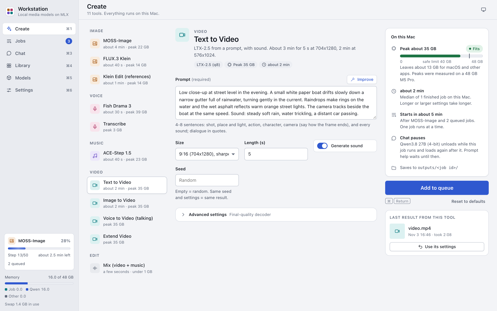

# Getting started

Workstation runs open image, voice, music and video models on your Apple Silicon Mac. A local language model (LLM)
helps you write prompts and answers in a chat. The models upload nothing. Only the web tools of an Agent chat send
data off the Mac, and only after you approve the call.



## What you need

- An Apple Silicon Mac. We built and tested the app on macOS 26 with an M5 Pro and 48 GB of memory.
- [Homebrew](https://brew.sh) with `ffmpeg`, `python@3.12`, `python@3.14`, `hf` and `uv`.
- About 160 GB of free disk space for all the models, less if you install only some of them.
- For Chat and prompt help: about 26 GB of memory (the LLM's peak of about 18 GB plus 8 GB for macOS).

The app keeps 8 GB of memory free for macOS and other apps. Each tool shows whether it fits your Mac. See
[Models](models.md#read-the-memory-fit).

## Install the app

1. Install the Homebrew packages:

   ```sh
   brew install ffmpeg python@3.12 python@3.14 hf uv
   ```

2. Clone the repository and make the app's environment:

   ```sh
   git clone https://github.com/0xbyt4/mlx-media-workstation.git
   cd mlx-media-workstation
   uv venv --python /opt/homebrew/bin/python3.12 .venv
   uv pip install --python .venv/bin/python -r requirements.txt
   ```

3. Copy `config.example.toml` to `config.toml`:

   ```sh
   cp config.example.toml config.toml
   ```

4. If you install the models in a folder other than `~/mlx-media`, change the paths in `config.toml`. You can also
   change them later in [Settings > Model paths](settings.md#model-paths).

The app does not include the models. You install each model that you want. See [Models](models.md).

## Start the app

Do one of these steps in the app folder:

- To open the app window, run `.venv/bin/python start.py`.
- To use a browser, run `.venv/bin/python start.py --browser`. Then open the link that it prints.
- To open only Chat, Models and Settings, run `.venv/bin/python start.py --chat`. See
  [Chat only](chat.md#chat-only).

The app uses port 7870 on `127.0.0.1`. Prefer the window to the browser: in `--browser` mode the browser sends the
session cookie to every server on `127.0.0.1`.

When you close the app window (or press Ctrl-C in `--browser` mode), the app cancels the queue and stops every
model process.

### Start from Finder or the Dock

1. In the app folder, run:

   ```sh
   scripts/build_apps.sh
   ```

2. Keep `Workstation.app` and `Workstation Chat.app` in the app folder. They run the repository that they sit in.
3. Drag them from that folder to the Dock.

`Workstation Chat.app` starts the chat profile. If `Workstation.app` is already open, `Workstation Chat.app` opens a
chat window on it. It does not start a second app, so the LLM loads only once.

## Make your first image

1. Start the app.
2. Open Models (Cmd-5). Install the mflux runtime and the FLUX.3 Klein weights. FLUX.3 Klein is gated: accept its
   licence first. See [Models](models.md).
3. Open Create (Cmd-1).
4. In the tool list, click FLUX.3 Klein.
5. Type a prompt, for example: `A red paper lantern on a wet stone street at night, warm light, close-up`.
6. Look at the "On this Mac" card. It shows the peak memory and whether the tool fits.
7. Press Generate, or press Cmd-Return.
8. Open Jobs (Cmd-2) to follow the progress. The finished image shows on the job card and in the Library.

The Edit tools (Mix, Join clips and Add Subtitles) need no model. You can use them before you install anything.

## The sections

The sidebar has six sections. The sidebar also shows the running job and a memory meter.

| Section | Shortcut | What you do there |
|---|---|---|
| Create | Cmd-1 | Pick a tool, fill in its form and press Generate. See [Create](create.md). |
| Jobs | Cmd-2 | Follow the running job, reorder the queue, read the results. See [Jobs and Library](jobs-and-library.md). |
| Chat | Cmd-3 | Talk with the local LLM. See [Chat](chat.md) and [Agent mode](agent-mode.md). |
| Library | Cmd-4 | Find every output of the finished jobs. See [Jobs and Library](jobs-and-library.md#library). |
| Models | Cmd-5 | Download weights and see what is installed. See [Models](models.md). |
| Settings | Cmd-6 | Theme, profile, LLM, jobs, agent and model paths. See [Settings](settings.md). |

The chat profile shows only Chat, Models and Settings, as Cmd-1 to Cmd-3.

## Keyboard shortcuts

On a keyboard without Cmd, Ctrl works too for Cmd-1 to Cmd-6 and Cmd-Return.

| Where | Keys | What it does |
|---|---|---|
| Everywhere | Cmd-1 to Cmd-6 | Opens a section, in sidebar order. |
| Sidebar | Arrow keys, Home, End | Move between the sections. |
| Create | Cmd-Return | Starts the job (Generate or Add to queue). |
| Chat | Return | Sends the message. |
| Chat | Shift-Return | Starts a new line. |
| Chat | Escape | Closes the Tools menu, or the chat list on a narrow window. |
| Jobs, a queued job | Option-Up Arrow, Option-Down Arrow | Moves the job up or down in the queue. |
| Library | Arrow keys, Home, End, Page Up, Page Down | Move between the output cards. |
| Library, the preview | Escape | Closes the preview. |
| An image viewer | Left Arrow, Right Arrow, Escape | Shows the previous or next image, or closes the viewer. |

## Where your files are

All paths are in the app folder, unless the table says otherwise.

| What | Where |
|---|---|
| A job: its settings and state, the model's log, the results | `outputs/<job id>/` (`job.json`, `job.log` and the result files) |
| A chat and the images and files sent in it | `outputs/chats/<chat id>/` |
| The work folder of an agent chat | `outputs/chats/<chat id>/ws/` |
| The log of the local LLM | `outputs/llm.log` |
| The local LLM's saved prompt cache of one chat (after a big job) | `outputs/llm-cache.safetensors` |
| The app log, when you start it from `Workstation.app` or `Workstation Chat.app` | `outputs/app.log` |
| The app log, when you start it from a terminal | The terminal |
| The settings | `config.toml` |
| The weights of MOSS-Image, FLUX.3 Klein and Qwen3-ASR | `~/.cache/huggingface/hub` |
| The other weights and the model environments | The paths in `config.toml` (by default under `~/mlx-media`) |

Settings > About shows the settings file, the outputs folder and the logs of this install.

## Update the app

1. Wait until the jobs end. Closing the app cancels the queue.
2. Quit the app.
3. In the app folder, get the new version and update the app's environment:

   ```sh
   git pull
   uv pip install --python .venv/bin/python -r requirements.txt
   ```

4. If you use `Workstation.app` or `Workstation Chat.app`, build them again:

   ```sh
   scripts/build_apps.sh
   ```

5. Start the app.
6. Open Models. Install a model or a runtime that shows as not installed.

Your `config.toml` and the `outputs` folder stay as they are. `git pull` does not change them.

## Uninstall the app

1. Quit the app.
2. Copy the outputs that you want to keep from `outputs/` to another folder.
3. Remove `Workstation.app` and `Workstation Chat.app` from the Dock.
4. Delete the app folder. This deletes `config.toml`, the outputs, the chats and the two apps.
5. Delete the model folders: `~/mlx-media`, or the paths in your `config.toml`.
6. Delete the cached weights in `~/.cache/huggingface/hub`, if no other program uses them:
   - `models--OpenMOSS-Team--MOSS-Image-SFT`
   - `models--black-forest-labs--flux-3-image-klein`
   - `models--mlx-community--Qwen3-ASR-0.6B-8bit`
7. Optional: log out of Hugging Face with `hf auth logout`.

Deleted files do not go to the Trash when you use `rm -rf`. Check each path before you delete it.
