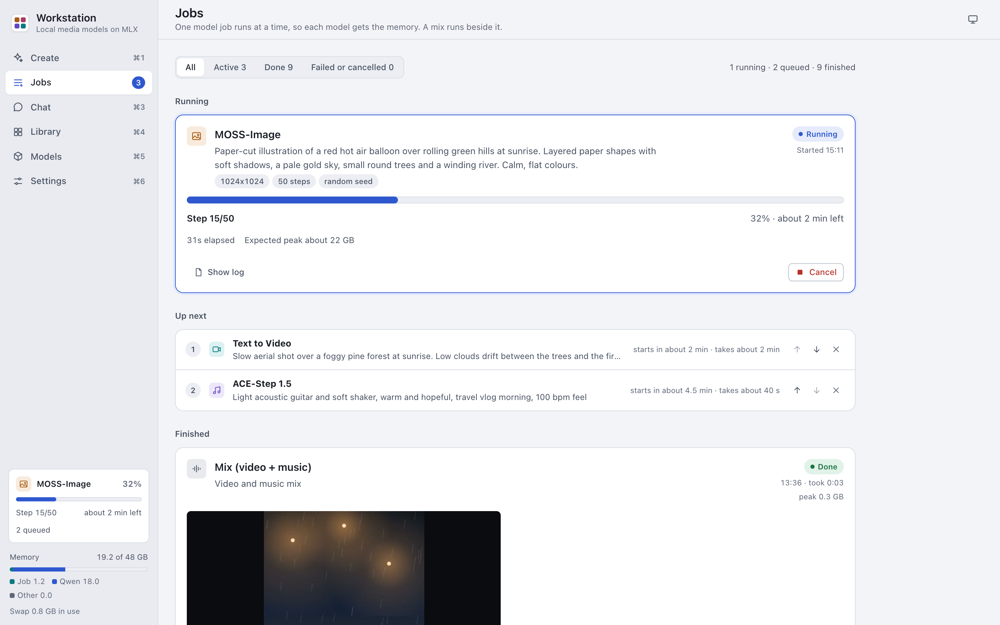
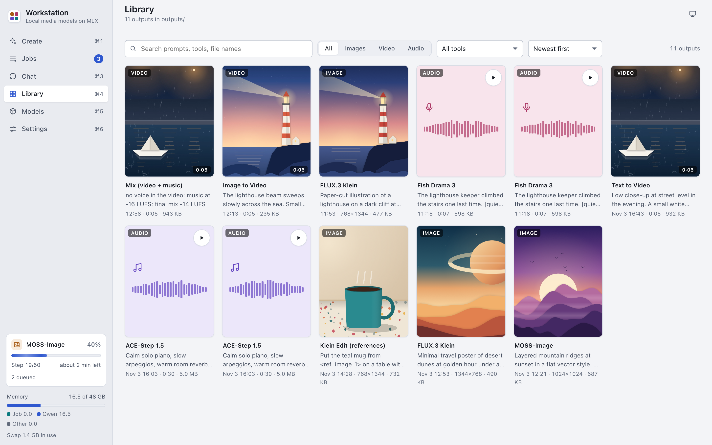

# Jobs and Library

Jobs shows the running jobs, the queue and the finished jobs. Library shows every output of the finished jobs.

## Jobs

Jobs that load a model run one at a time, in the order of the queue. Each model needs most of the memory of a 48 GB
Mac, so two model jobs never run together.

An Edit job (Mix, Join clips or Add Subtitles) loads no model. It uses ffmpeg, about 1 GB of memory or less, and a
few seconds. So an Edit job does not wait for the model jobs: it runs next to the running model job. Edit jobs run one
at a time.

The Jobs screen has three parts:

- **Running**: the jobs that run now, each with a progress bar, the stage, the elapsed time and the expected peak.
  This is one model job, and an Edit job when one runs next to it.
- **Up next**: the queued model jobs, in order. Below them, under "Loads no model", the queued Edit jobs in their own
  list. When earlier jobs of the same tools finished on this Mac, each row shows when it is expected to start.
- **Finished**: the jobs that are done, failed or cancelled, newest first. Jobs shows the newest 30. Press "Show 30
  more" at the end of the list to see older jobs.

The buttons at the top filter the list: All, Active, Done, or Failed or cancelled.

The sidebar shows the running job on every screen. When an Edit job runs next to a model job, it shows "Also
running" with the Edit job. Click it to open Jobs. The memory meter under it shows the memory of the model job, the
local LLM and other apps. It warns when macOS swaps.

### Follow a running job

1. Open Jobs (Cmd-2).
2. Read the stage and the progress bar of the running job.
3. To see the model's output, press "Show log".

The app can show a macOS notification when a job is done or failed. Turn it on or off in
[Settings > Jobs](settings.md#jobs).

### Cancel a running job

1. Press Cancel on the running job.
2. Press "Cancel job" to confirm, or "Keep running" to go back.

The app discards the part that is done and frees the memory.

### Change the queue

- To move a queued job, press its up or down arrow. You can also focus the job and press Option-Up Arrow or
  Option-Down Arrow. A job moves only in its own list: an Edit job never moves past a model job.
- To remove a queued job, press its remove button. This takes one click and has no Undo, because the next job can
  start within seconds.

### Read a finished job

A finished job card shows:

- The outputs: images, audio players, videos or text, with a note (for example the speech check of a voice take).
  An image shows as a small copy. Click it to see the full image. A video shows its first frame and loads when you
  press Play.
- The prompt in plain words: "reference 1" for `<ref_image_0>`, and no `<|speaker:0|>` tags. A text with two
  speakers shows "Speaker 0:" and "Speaker 1:". "Use these settings" and "All settings" keep the text as it was sent.
- "Send to": puts an output into a file field of another tool. See [Create](create.md#use-outputs-in-other-tools).
- "Use these settings": opens the tool in Create with the job's settings. Add the files again.
- "All settings": the job's settings.
- "Technical details": the end of the model's log.

A failed job shows a plain title and the steps to fix it. These failures have their own title:

| Title | Fix |
|---|---|
| A model file is missing | Open Models and download the model again. See [Troubleshooting](troubleshooting.md#a-model-file-is-missing). |
| macOS stopped the job: memory may have run out | Quit large apps. Pick a smaller size, a shorter length or fewer takes. See [Troubleshooting](troubleshooting.md#out-of-memory). |
| This video size does not work here | Use a clip whose sides are a multiple of 64. |

### Delete a job

1. Press the delete button (the bin) on a finished job.
2. Press Delete to confirm.

This deletes the folder `outputs/<job id>/` and every file in it. You cannot undo it.

## Library

The Library shows every output of the jobs that are done. Failed and cancelled jobs have no outputs here.

### Find an output

1. Open Library (Cmd-4).
2. Type in the search field. The search looks in prompts, scripts, descriptions, tool names and file names.
3. Optional: pick a type (All, Images, Video or Audio), a tool, or the sort order (Newest first or Oldest first).

An audio card has a play button. Use the arrow keys to move between the cards. An image or video card shows a small
copy of the image or of the video's first frame. The preview shows the full file.

### Open an output

Click a card. A preview opens with:

- The facts: when it was made, how long it took, the peak memory, the size in pixels, the length and the file size.
- The prompt, script or description, and the other settings.
- The file path.
- These buttons: "Use these settings", "Send to", "Download", "Show in Finder" and "Delete".

Press Escape or the close button to close the preview.

### Delete an output

1. Open the output.
2. Press Delete.
3. Press Delete again to confirm.

This removes only that file from `outputs/<job id>/`. You cannot undo it. To delete the whole job, delete it in
Jobs.
