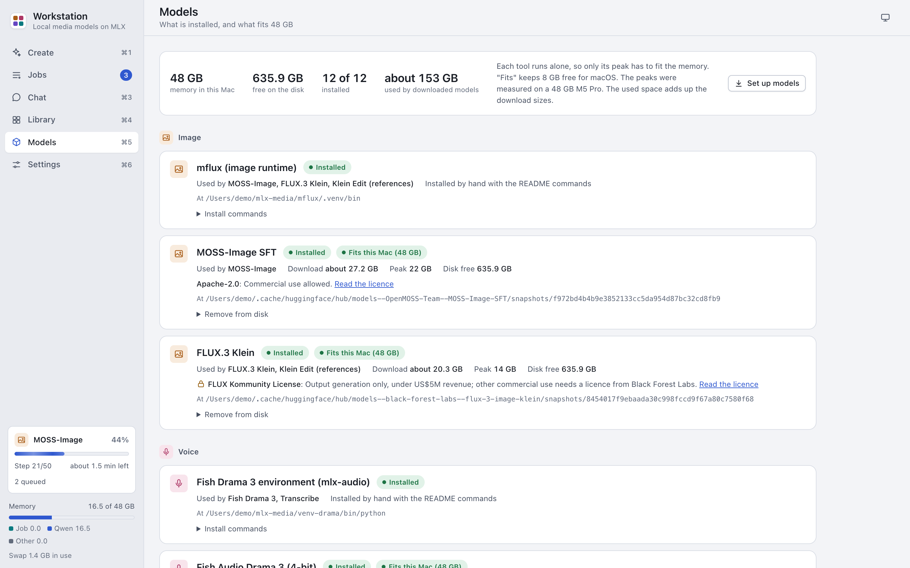

# Models

The app does not include the models. The Models screen shows what each tool needs, what is installed, the download
size, the peak memory and whether it fits this Mac. It downloads the weights. You install the runtimes (the model
environments) with commands in Terminal.



Each model has two parts:

- **A runtime**: the environment or code checkout that runs the model. The app cannot install it. Its card shows the
  commands.
- **The weights**: the model files. The app downloads them.

| Runtime | Weights | Tools | Download | Peak |
|---|---|---|---|---|
| mflux (image runtime) | MOSS-Image SFT | MOSS-Image | about 27.2 GB | 22 GB |
| mflux (image runtime) | FLUX.3 Klein (gated) | FLUX.3 Klein, Klein Edit | about 20.3 GB | 14 GB |
| Fish Drama 3 environment (mlx-audio) | Fish Audio Drama 3 (4-bit) | Fish Drama 3 | about 23.8 GB | 39 GB |
| Fish Drama 3 environment (mlx-audio) | Qwen3-ASR 0.6B (speech check) | Fish Drama 3, Transcribe | about 1.0 GB | 3 GB |
| ACE-Step 1.5 checkout | ACE-Step 1.5 turbo | ACE-Step 1.5 | about 10.1 GB | 23 GB |
| ltx-2-mlx (video runtime) | LTX-2.5 (q8) (gated) | Text to Video, Image to Video, Voice to Video, Extend Video | about 54.1 GB | 35 GB |
| Local LLM environment (mlx-vlm) | Qwen3.8 27B (4-bit) | Prompt help, Chat | about 16.1 GB | 18 GB |
| Local LLM environment (mlx-vlm) | Qwen3.8 27B DFlash2 draft (optional) | Faster chat answers | about 3.85 GB | about 3 GB more |

The Edit tools (Mix, Join clips and Add Subtitles) need no model. They use `ffmpeg` from Homebrew.

## Set up the models

When models are missing, a setup card shows at the top of the Models screen. It has three steps: pick the models,
accept the licences of the gated ones, and download. Install the runtimes first: the card picks for you only
the models whose runtime is installed and that fit this Mac.

1. Open Models (Cmd-5).
2. Install the runtimes of the tools that you want. See [Install a runtime](#install-a-runtime). The setup card lists
   them under "Environments you install by hand".
3. Press "Set up models".
4. Pick the models. The card shows the total download against the free disk.
5. Press "Next: licences" when you picked a gated model, or "Download selected" when you did not.
6. For each gated model, accept its licence. See [Accept a gated licence](#accept-a-gated-licence).
7. Press "Download".

The ACE-Step 1.5 weights go into the ACE-Step checkout. Their download waits until the checkout exists.

To download one model, press Download on its card.

- Downloads run one at a time, in the order of the queue. A failed download does not stop the others.
- The app keeps 10 GB of disk free for macOS. It refuses a download that leaves less.
- Files that finished stay when a download fails or when you cancel it. The next download skips them.
- Each download pins the revision that we tested.

The weights of MOSS-Image, FLUX.3 Klein and Qwen3-ASR go into the Hugging Face cache (`~/.cache/huggingface/hub`).
The other weights go to the paths in `config.toml`.

## Accept a gated licence

FLUX.3 Klein and LTX-2.5 are gated on Hugging Face. The download works only after you accept the licence with your
Hugging Face account. Do these steps once:

1. Open the model page and log in to Hugging Face:
   [FLUX.3 Klein](https://huggingface.co/black-forest-labs/flux-3-image-klein) or
   [LTX-2.5 (q8)](https://huggingface.co/dgrauet/ltx-2.5-mlx-q8).
2. Accept the licence on that page.
3. In Terminal, in the app folder, log in once on this Mac with a Hugging Face access token:

   ```sh
   .venv/bin/hf auth login
   ```

4. In the app, tick "I accepted the licence on Hugging Face" (or "I accepted the licence of" the model in the setup
   card).
5. Press Download.

The app never asks for your Hugging Face token and never stores it. The app and the `hf` command from Homebrew use
the same login.

## Install a runtime

1. Find the runtime's card on the Models screen. It shows "Installed by hand with the README commands".
2. Press the copy button of the commands.
3. Paste the commands in Terminal and run them.
4. Press "Check again" on the card.

The commands put everything under `~/mlx-media`. If you install a runtime in another folder, set its path in
[Settings > Model paths](settings.md#model-paths). A path changed in Settings counts after a restart.

The same commands, with the `hf download` commands for the weights, are in the
[README](../../README.md#install-the-models).

## Read the memory fit

The app keeps 8 GB of memory for macOS and other apps. Each model card shows one of these:

| Pill | Meaning |
|---|---|
| Fits | The peak plus 8 GB is at most this Mac's memory. |
| Tight | The peak is at most this Mac's memory less 2 GB. Quit other large apps before you start. |
| Needs N GB | The peak needs a Mac of N GB. The model can still run, but macOS swaps: the job can take many times longer or stop. |

Each tool runs alone, so only its own peak has to fit. The peaks were measured on a 48 GB M5 Pro.

The local LLM shares the memory with the jobs. On a 48 GB Mac, it unloads for the voice, music and video jobs and
loads again after them. See [Chat](chat.md#when-a-job-runs).

## Remove a model

The app does not delete models.

1. On the model's card, open "Remove from disk".
2. Quit the app.
3. Copy the command and run it in Terminal. It deletes the model's folder for good.

## Licences

Each model has its own licence. Some limit commercial use. The model card shows a one-line summary and a link
("Read the licence"). The full table is in the [README](../../README.md#model-licences). Read the licence before you
use a model or its output.
