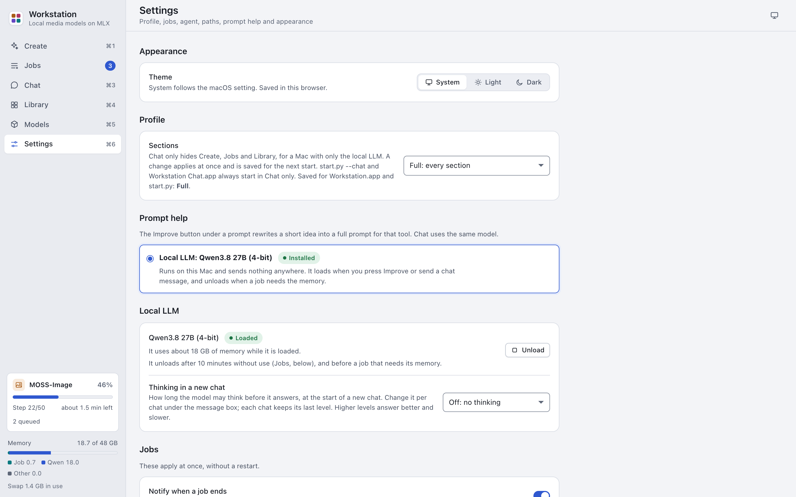

# Settings

The Settings screen (Cmd-6) changes the app's settings. Most of them are in `config.toml` in the app folder. If the
file does not exist, the app uses the defaults and Settings makes the file when you save.



Some changes apply at once. Others apply after a restart, because the app reads them only when it starts. A banner
"Restart the app to use the new settings" shows until you restart.

| Section | `config.toml` | Applies |
|---|---|---|
| Appearance | none (saved in this window or browser) | At once |
| Profile | `[app] profile` | At once |
| Prompt help | `[assist] provider` | After a restart |
| Local LLM | `[app] chat_effort` | At once |
| Jobs | `[app] notify`, `keep_awake`, `llm_idle_minutes` | At once |
| Agent | `[agent]` | After a restart |
| Chat memory | none (`outputs/memory/settings.json`) | At once |
| MCP servers | none (`outputs/mcp_servers.json` and the Keychain) | At once, for new agent chats |
| Model paths | `[paths]` | After a restart |

If you edit `config.toml` by hand, restart the app. When the file has an error, Settings shows "config.toml cannot
be read" and the app keeps the values that it read at start.

## Appearance

**Theme**: System, Light or Dark. System follows the macOS setting. The theme button in the toolbar changes it too.

## Profile

**Sections**: "Full: every section" or "Chat only: Chat, Models and Settings". Chat only hides Create, Jobs and
Library, for a Mac with only the local LLM. See [Chat only](chat.md#chat-only).

The change applies at once and is saved for the next start of `Workstation.app` and `start.py`. `start.py --chat` and
`Workstation Chat.app` always start in Chat only.

A window that opened next to the running app always keeps its own profile. Change the profile in the app's own
window.

## Prompt help

The Improve button under a prompt rewrites a short idea into a full prompt for that tool. The only provider is the
local LLM, Qwen3.8 27B (4-bit). It runs on this Mac and sends nothing anywhere. See
[Create](create.md#improve-a-prompt).

The chat profile does not show this section.

## Local LLM

- **Status**: whether the model is loaded and how much memory it uses. Press Unload to free its memory now. It loads
  again with the next request.
- **Thinking in a new chat**: the thinking level of a new chat. The choices are Off, Low, Medium, High, XHigh and Max.
  Each chat keeps its last level. See [Chat](chat.md#pick-a-thinking-level).

## Jobs

In the chat profile this section is "Memory" and has only the last setting.

| Setting | Default | What it does |
|---|---|---|
| Notify when a job ends | on | A macOS notification with the tool name when a job is done or failed. |
| Keep the Mac awake while jobs run | on | The Mac does not go to sleep while a job is queued or running. The display may still sleep. |
| Unload the chat model when idle | After 10 minutes | Frees the LLM's memory after this time without a prompt help or chat request. The choices are 5, 10 or 30 minutes, 1 hour, or Never. |

## Agent

These settings are for the tools of an Agent chat. See [Agent mode](agent-mode.md) and
[AGENT.md](../AGENT.md#settings).

| Setting | Key | Default | What it does |
|---|---|---|---|
| Sandbox Python | `python` | empty | The Python that the Python tool runs. Empty means the app's own Python with the standard library only. |
| SearXNG URL | `searxng_url` | empty | Optional. A SearXNG instance you run yourself, with the JSON format on. Web search asks it first. |
| Wikipedia language | `wikipedia_language` | `en` | The Wikipedia that web search asks. |
| Marginalia Search | `marginalia` | on | Web search also asks Marginalia Search, with the shared key "public". That key is often rate limited. |

Press Save, then restart the app.

### Use numpy, pandas or matplotlib in the sandbox

1. In Terminal, make an environment for the sandbox:

   ```sh
   uv venv --python 3.12 ~/mlx-media/venv-sandbox
   ```

2. Install the packages:

   ```sh
   uv pip install --python ~/mlx-media/venv-sandbox/bin/python numpy==2.5.4 pandas==3.1.0 matplotlib==3.11.2
   ```

3. In Settings > Agent, enter `~/mlx-media/venv-sandbox/bin/python` as the Sandbox Python.
4. Press Save.
5. Restart the app.

The path must be absolute ("~" is allowed) and the file must exist. No other user may be able to change the file or
the folders above it.

## Chat memory

The memory switches, the entries of the two memory stores and the chat search index. See
[Chat memory](memory.md).

| Setting | Default | What it does |
|---|---|---|
| Memory | on | Agent and Workstation chats see the saved entries and can save new ones. Off: no chat sees or changes the memory, and chat search is off. |
| Ask before saving | on | Each change the model wants to make shows on an approval card first. |
| Memory in General chats | off | General chats see the memory too. |

A change applies at once. A chat keeps the memory it started with.
## MCP servers

Add, approve, test and remove MCP servers. Their tools go to the agent of new Agent chats. Each server needs your
approval of its command line, and each tool needs your approval of its definition. Secrets go to the macOS Keychain.
The steps are in [MCP servers](mcp-servers.md).

## Model paths

Where each model is installed. A row shows "Not found" with the path that the app looked for. A relative path counts
from the app folder.

| Setting | Key | Default | Used by |
|---|---|---|---|
| mflux environment | `mflux_bin` | `~/mlx-media/mflux/.venv/bin` | MOSS-Image, FLUX.3 Klein, Klein Edit |
| LTX-2.5 environment | `ltx_bin` | `~/mlx-media/venv-ltx/bin` | The video tools |
| LTX-2.5 weights | `ltx_model` | `~/mlx-media/models/ltx-2.5-mlx-q8` | The video tools |
| Fish Drama 3 python | `drama_python` | `~/mlx-media/venv-drama/bin/python` | Fish Drama 3, Transcribe |
| Fish Drama 3 weights | `drama_model` | `~/mlx-media/models/fish-audio-drama-3-4bit` | Fish Drama 3 |
| ACE-Step 1.5 checkout | `ace_dir` | `~/mlx-media/ace-step` | ACE-Step 1.5 |
| Local LLM python | `qwen_python` | `~/mlx-media/venv-qwen/bin/python` | Chat, Prompt help |
| Local LLM weights | `qwen_model` | `~/mlx-media/models/qwen3.8-27b-4bit` | Chat, Prompt help |

To change a path:

1. Type the new path in the row.
2. Press Save. Save writes only the paths that you changed.
3. Restart the app.

The chat profile shows only the two Local LLM rows.

## About

The version, the settings file, the outputs folder, the logs, the server address and links to the README.
